# GDD - Game Design Document - Módulo 1 - Inteli

## Nome do Grupo: Level Zero

#### Nomes dos integrantes do grupo

Ana Cristina Alves Jardim  
Henrique de Lima da Rós  
Lucas Garcia Rodrigues Lopes  
Lucas Michel Pereira  
Nicole Zanin Silva  
João Cardoso Dias  
Teodoro Borges de Carvalho Neira  

## Sumário

[1. Introdução](#c1)

[2. Visão Geral do Jogo](#c2)

[3. Game Design](#c3)

[4. Desenvolvimento do jogo](#c4)

[5. Casos de Teste](#c5)

[6. Conclusões e trabalhos futuros](#c6)

[7. Referências](#c7)

[Anexos](#c8)

 

# 1. Introdução (sprints 1 a 4)

## 1.1. Plano Estratégico do Projeto

### 1.1.1. Contexto da indústria (sprint 2)

Os fundos de investimento tiveram aportes líquidos de R$ 40,1 bilhões em abril de 2024, de acordo com a ANBIMA (Associação Brasileira das Entidades dos Mercados Financeiro e de Capitais). O valor representa a segunda maior captação líquida do ano, atrás apenas de janeiro, que fechou com R$ 52,1 bilhões. O acumulado de 2024 é positivo em R$ 150,8 bilhões. O BTG Pactual é um banco de investimentos que fornece uma grande gama de serviços, como mercado de capitais, prestação de serviço de consultoria financeira para empresas e etc. Fornecem serviços de corretagem, compensação e custódia de vários produtos no mercado latino-americano para uma base de clientes diversificada(ANBIMA, s.d.).

#### 1.1.1.1. Modelo de 5 Forças de Porter (sprint 2)

O BTG Pactual é considerado um dos líderes no cenário dos investimentos, operando em um mercado caracterizado por uma concorrência acirrada. Logo, para uma análise aprofundada do contexto desse setor, é preciso recorrer a uma ferramenta de análise estratégica reconhecida, como o modelo das 5 Forças de Porter. Conforme apresentado por Magretta (2019), para que uma empresa/organização avalie ou formule uma estratégia de mercado é preciso utilizar a estrutura das cinco forças, essa estrutura foi formulada por Michael Porter e fornece parâmetros para medir o desempenho superior e foca na competição a ser enfrentada. Além disso, essa ferramenta busca entender o que acontece em determinado setor, fornecendo uma visão clara e direta que está relacionada com a lucratividade do mercado. Para obter uma análise completa, as cinco forças de Porter se dividem em ameaça de entrada de novos concorrentes, ameaça de produtos substitutos, poder de negociação dos clientes, poder de negociação dos fornecedores e rivalidade entre os concorrentes (PORTER, 1896). Elas são:

**Ameaça de entrada de novos concorrentes:** consiste nas métricas de entrada no setor. Quanto mais difícil for a entrada, menor é a concorrência e maior a probabilidade de lucros a longo prazo. Segundo Porter (1896), as barreiras que dificultam a entrada de novos concorrentes são: economias de escala, diferenciação de produto, exigências de capital, custo de troca, acesso aos canais de distribuição, desvantagem de custos e políticas governamentais(NAKAGAWA, s.d.).

**Ameaça de Produtos Substitutos:** refere-se à facilidade com que o comprador pode substituir um tipo de produto ou serviço por outro(NAKAGAWA, s.d.).

**Poder de Barganha dos Compradores:** refere-se à influência dos clientes em relação ao preço de aquisição do produto. É considerado alto quando os clientes compram em grandes volumes, têm interesse em economias e estão preocupados com a qualidade do produto adquirido(NAKAGAWA, s.d.).

**Poder de Barganha dos Fornecedores:** é definido pelo poder de negociação em insumos de produção e disponibilidade de materiais. Os fornecedores são considerados poderosos quando não têm que lutar contra outros produtos substitutos, não dependem dos compradores e possuem produtos únicos e insubstituíveis para os compradores(NAKAGAWA, s.d.).

**Rivalidade entre os Concorrentes Existentes:** define o nível de competição em um setor. É mais intenso quando o número de empresas competindo é grande e quando as empresas sofrem restrições de tempo para venda do produtohttps (NAKAGAWA, s.d.).

Utilizando os conceitos discutidos, é possível aplicar a estrutura das 5 Forças de Porter ao BTG Pactual para avaliar sua posição competitiva e identificar os principais impulsionadores de lucratividade e os desafios enfrentados pela empresa.

#
                                                               Figura xx

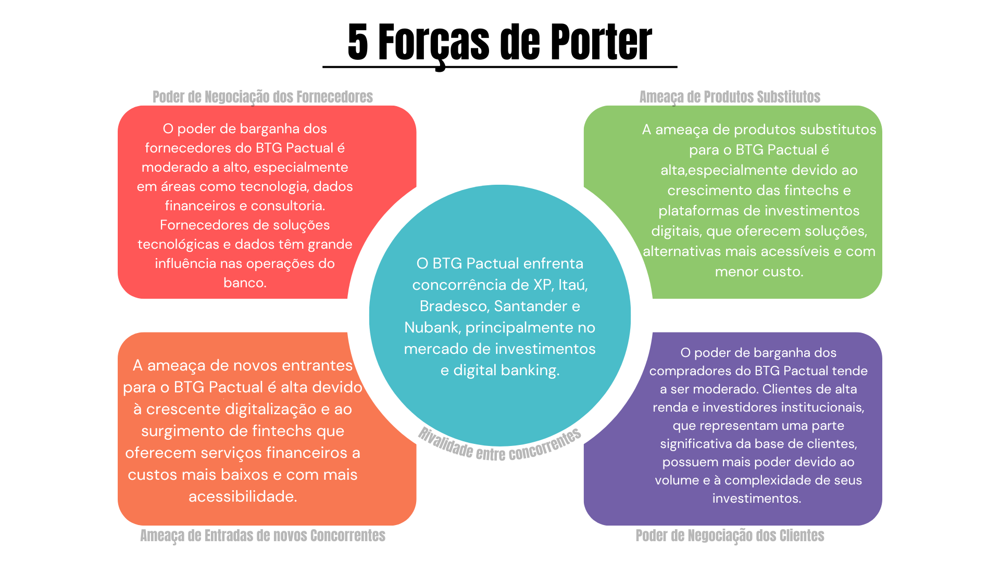

Autores: Grupo Level Zero

#

**Ameaça de produtos substitutos:** o nível de ameaça de produtos substitutos para o BTG Pactual varia conforme seus segmentos de atuação, mas é alto em algumas áreas estratégicas. No mercado de investimentos, fintechs e corretoras independentes oferecem alternativas acessíveis e automatizadas, desafiando os serviços tradicionais de wealth management e asset management. No corporate banking e mercado de crédito, bancos digitais e plataformas de financiamento descentralizado (DeFi) criam novas formas de captação de recursos, reduzindo a dependência de grandes instituições(DCF MODELING, s.d.).

**Poder de negociação dos compradores:** o poder de negociação dos compradores do BTG Pactual pode ser considerado moderado, variando conforme o perfil do cliente. Grandes investidores, clientes institucionais e grandes fundos de investimento exercem uma influência significativa, pois movimentam altos volumes de capital e têm maior poder de barganha. Eles podem negociar taxas mais competitivas, acesso a produtos exclusivos, serviços personalizados e condições diferenciadas para otimizar seus investimentos(DCF MODELING, s.d.)

**Rivalidade entre os concorrentes:** a rivalidade entre os concorrentes do BTG Pactual é alta, especialmente no setor de investimentos e serviços financeiros. O mercado é altamente competitivo, com a presença de grandes bancos tradicionais, corretoras independentes e fintechs inovadoras, todos disputando a preferência de investidores institucionais e clientes de varejo. Os bancos tradicionais, como Itaú, Bradesco e Santander, possuem grande capilaridade e uma base consolidada de clientes, o que os torna concorrentes diretos em diversas frentes. Já as corretoras independentes, como XP Investimentos e Genial, se destacam pela oferta de plataformas digitais ágeis e produtos financeiros personalizados, atraindo investidores que buscam maior autonomia e diversificação(DCF MODELING, s.d.).

**Poder de negociação dos fornecedores:** o poder de barganha dos fornecedores do BTG Pactual varia de moderado a alto, especialmente em setores estratégicos como tecnologia, dados financeiros e consultoria especializada. Fornecedores de soluções tecnológicas, plataformas de análise de mercado e serviços de infraestrutura digital desempenham um papel essencial no suporte às operações do banco, tornando-se parceiros-chave na execução de suas atividades. A dependência de dados precisos e atualizados, bem como de sistemas robustos e seguros, confere a esses fornecedores uma influência significativa. No entanto, o BTG Pactual, por ser uma das maiores instituições financeiras da América Latina, possui um forte poder de negociação. Sua relevância no setor e seu volume de operações permitem que o banco exerça influência sobre os contratos, buscando sempre as melhores condições comerciais, alinhamento estratégico e inovação contínua. Além disso, a diversificação de fornecedores e investimentos em tecnologia própria ajudam a reduzir a dependência excessiva de qualquer parceiro específico, equilibrando essa dinâmica de poder(DCF MODELING, s.d.).

**Ameaça de entrada de novos concorrentes:** a ameaça de entrada de novos concorrentes no mercado financeiro, especialmente no setor de investimentos, varia de moderada a alta. A indústria financeira é caracterizada por barreiras de entrada significativas, como a necessidade de grandes investimentos iniciais, conformidade regulatória rigorosa e a construção de uma infraestrutura robusta para atender a clientes de alta complexidade. No entanto, a transformação digital e o crescimento das fintechs têm diminuído algumas dessas barreiras, permitindo a entrada de novos players com modelos de negócios mais ágeis e custos mais baixos. As fintechs, em particular, têm se mostrado uma ameaça crescente, oferecendo soluções inovadoras, como plataformas de investimentos automatizados (robo-advisors), serviços bancários digitais e investimentos de impacto, que atraem, principalmente, os consumidores mais jovens e aqueles em busca de maior flexibilidade e custos reduzidos. Empresas de tecnologia também estão cada vez mais entrando no setor financeiro, trazendo expertise em dados, inteligência artificial e blockchain, o que pode representar uma disrupção no mercado(DCF MODELING, s.d.).

Um exemplo prático da importância das Cinco Forças de Porter em relação ao BTG Pactual pode ser visto na crescente competição com fintechs e corretoras independentes, especialmente no segmento de investimentos. A ameaça de produtos substitutos tem se intensificado com o surgimento de plataformas digitais que oferecem produtos de investimento de forma simplificada, com baixas taxas e experiência 100% digital. Diante disso, a estratégia do BTG foi fortalecer sua presença digital por meio de iniciativas como a plataforma BTG Pactual digital, que oferece acesso a investimentos com taxas competitivas, interface intuitiva e serviços personalizados. Essa resposta estratégica mostra como a análise das Cinco Forças permitiu ao banco identificar riscos e oportunidades, adaptando-se às mudanças do mercado para manter sua posição competitiva(DCF MODELING, s.d.).

Portanto,após a análise das Cinco Forças de Porter percebe-se que é uma ferramenta extremamente abrangente para avaliar o ambiente competitivo de uma indústria e ajudar as empresas a desenvolver estratégias eficazes para superar dilemas e aproveitar oportunidades. Ao entender tais forças, o BTG Pactual pode posicionar-se de forma mais competitiva e realista em seu mercado-alvo(DCF MODELING, s.d.).

### 1.1.2. Análise SWOT (sprint 2)

A análise SWOT é uma ferramenta utilizada para identificar as forças, oportunidades, fraquezas e ameaças de uma empresa. Dessa forma, serve como uma forma de identificar oportunidades de melhoria frente à concorrência e à própria equipe, promovendo uma visão do atual cenário da empresa. No contexto da análise SWOT, há os fatores internos e externos. Entre os fatores internos, destacam-se as forças, que representam os aspectos positivos da empresa, como recursos, competências e ações estratégicas que proporcionam uma vantagem competitiva. Enquanto as fraquezas são o oposto, são as iniciativas internas que estão abaixo do esperado e indicam o que precisa ser feito para melhorar na empresa. Quanto aos fatores externos há as oportunidades e as ameaças. As oportunidades são as iniciativas externas às empresas, mas que promovem uma melhor posição competitiva. Em relação às ameaças, são os fatores externos que estão fora do controle da empresa e podem impactar negativamente o cenário competitivo. Desse modo, considerando as concepções da Análise SWOT foi possível identificar as forças, fraquezas, oportunidades e ameaças que contemplam o BTG Pactual, conforme consta abaixo(ASANA - 2025).

Figura 2: Análise SWOT

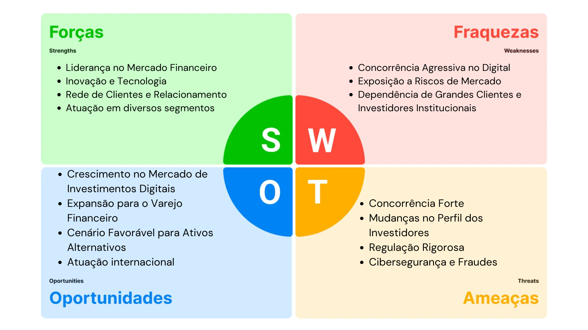

Autores: Grupo Level Zero

**Forças:**

- **Liderança no mercado financeiro:** o BTG Pactual é o maior banco de investimentos da América Latina, com alta presença no setor financeiro(GLOBALDATA).

- **Inovação e tecnologia:** forte investimento em soluções digitais e plataformas tecnológicas, como o BTG Pactual Digital, permitindo o crescimento no varejo financeiro(GLOBALDATA).

- **Rede de clientes e relacionamento:** possui uma base sólida de clientes institucionais e de alta renda, além de um forte relacionamento com empresas e investidores(GLOBALDATA).

- **Atuação em diversos segmentos:** mercado de capitais, crédito corporativo e gestão de fortunas, reduzindo riscos de dependência em um único setor(GLOBALDATA).

**Fraquezas:**

- **Concorrência agressiva no digital:** no segmento de varejo digital, enfrenta concorrentes como Nubank, XP Investimentos e bancos tradicionais,que possuem forte base de clientes(GLOBALDATA).

- **Exposição a riscos de mercado:** como banco de investimentos, está altamente exposto a oscilações macroeconômicas e crises financeiras(GLOBALDATA).

- **Dependência de grandes clientes e investidores institucionais:** a maior parte das receitas vem de clientes de alta renda e grandes empresas, tornando-o vulnerável a mudanças de comportamento desse público(GLOBALDATA).

**Ameaças:**

- **Concorrência forte:** disputa acirrada com bancos tradicionais e fintechs, que oferecem serviços mais acessíveis e taxas reduzidas(GLOBALDATA).

- **Mudanças no perfil dos investidores:** novas gerações de investidores buscam alternativas mais simples e acessíveis, podendo migrar para concorrentes que ofereçam plataformas mais amigáveis(GLOBALDATA).

- **Regulação rigorosa:** o setor financeiro está sujeito a regulações constantes, o que pode limitar algumas operações do banco(GLOBALDATA).
- **Cibersegurança e Fraudes:** como banco digital e de investimentos, enfrenta riscos de ataques cibernéticos e vazamento de dados(GLOBALDATA).

**Oportunidades:**

- **Crescimento no mercado de investimentos digitais:** com a popularização do investimento online, o BTG pode ampliar sua base de clientes via BTG Pactual Digital(GLOBALDATA).

- **Cenário favorável para ativos alternativos:** o aumento do interesse por ativos como fundos estruturados, private equity e crédito privado pode impulsionar o banco(GLOBALDATA).

- **Atuação internacional:** o BTG Pactual tem expandido sua atuação internacionalmente, podendo capturar mais oportunidades fora do Brasil(GLOBALDATA).

- **Expansão para o varejo financeiro:** o banco tem ampliado sua atuação para o público de alta renda e varejo, competindo com fintechs e bancos tradicionais(GLOBALDATA).

### 1.1.3. Missão / Visão / Valores (sprint 2)

O BTG Pactual tem como missão prover soluções financeiras inovadoras e eficientes, combinando expertise e tecnologia para gerar valor sustentável a clientes, investidores e à sociedade. O banco busca transformar o mercado por meio de um atendimento consultivo, focado em resultados, sempre priorizando a excelência e a inovação. Sua visão é consolidar-se como a principal instituição financeira independente da América Latina, sendo reconhecido pela sua capacidade de adaptação, impacto positivo e liderança no setor de investimentos e serviços financeiros. Seus valores são pautados pela meritocracia, parceria e foco no cliente, promovendo um ambiente dinâmico e colaborativo. Além disso, o compromisso com a integridade, a excelência e a visão de longo prazo fortalece sua cultura empreendedora, impulsionando o crescimento sustentável e a criação de soluções diferenciadas para o mercado(BTG PACTUAL).

Da mesma forma, nosso projeto visa transformar o onboarding de novos analistas de tecnologia do BTG Pactual, oferecendo uma experiência gamificada, imersiva e alinhada aos desafios reais da empresa. Nossa missão é tornar o aprendizado dinâmico e estratégico, refletindo o dinamismo do mercado financeiro. Assim como o banco se guia por valores como meritocracia, parceria e foco no cliente, nosso projeto também se baseia na excelência e inovação, garantindo uma experiência envolvente e eficiente. Além disso, buscamos incentivar a autonomia e o protagonismo, promovendo um aprendizado ativo e contínuo que vai além do onboarding. Valorizamos o impacto e a responsabilidade, demonstrando como cada decisão afeta os resultados do banco, e promovemos a colaboração e o engajamento, fortalecendo a integração entre os profissionais.

### 1.1.4. Proposta de Valor (sprint 4)

O conceito do _Canvas_ da Proposta de Valor foi criado por Alex Osterwalder, no livro _Value Proposition Design: How to Create Products and Services Customers want_. Na obra, Osterwalder (2014) apresenta um modelo com dois lados: o perfil do consumidor e o mapa de valor. 

No perfil do consumidor, destacam-se três elementos principais:

- **Tarefas**: o que o consumidor precisa realizar.
- **Dores**: os obstáculos que dificultam a execução dessas tarefas.
- **Ganhos**: os fatores que tornam a experiência do consumidor mais satisfatória, considerando o contexto das tarefas.

O principal objetivo dessa parte da ferramenta é verificar o conhecimento sobre o consumidor.

Já o mapa de valor contém os seguintes elementos:
- **Analgésicos**: soluções que eliminam ou minimizam as dores do cliente.
- **Criadores de ganho**: tudo o que pode melhorar a experiência do consumidor, agregando mais valor ao produto ou serviço.
- **Produtos e serviços**: produtos ou seviços que sirvam como solução para os problemas apresentados

Dessa forma, o _canvas_ permite uma análise detalhada da solução, verificando se ela se encaixa com aquilo que o consumidor realmente deseja.

Por esse caminho, consideramos que o _Canvas_ da Proposta de Valor é capaz de esclarecer os principais aspectos desejados pelo BTG Pactual em nosso projeto. Além disso, ele permite que alinhemos nossa proposta com os interesses da empresa, mapeando as dores e ganhos do cliente, e como o nosso produto é capaz de suprimir os problemas e alavancar os ganhos. Segundo a linha de raciocínio de Osterwalder (2014), o consumidor tem diversas expectativas para a solução, porém entende que não pode ter todos os seus desejos cumpridos. Logo, corroboramos com esse pensamento, aplicando-o no desenvolvimento do nosso projeto, priorizando os aspectos que terão maior impacto na solução dos desafios apresentados. Sob esse viés, elaboramos o _Canvas_ da Proposta de Valor, visto na imagem à seguir:

#

Figura 3: _Canvas_ de Proposta de Valor

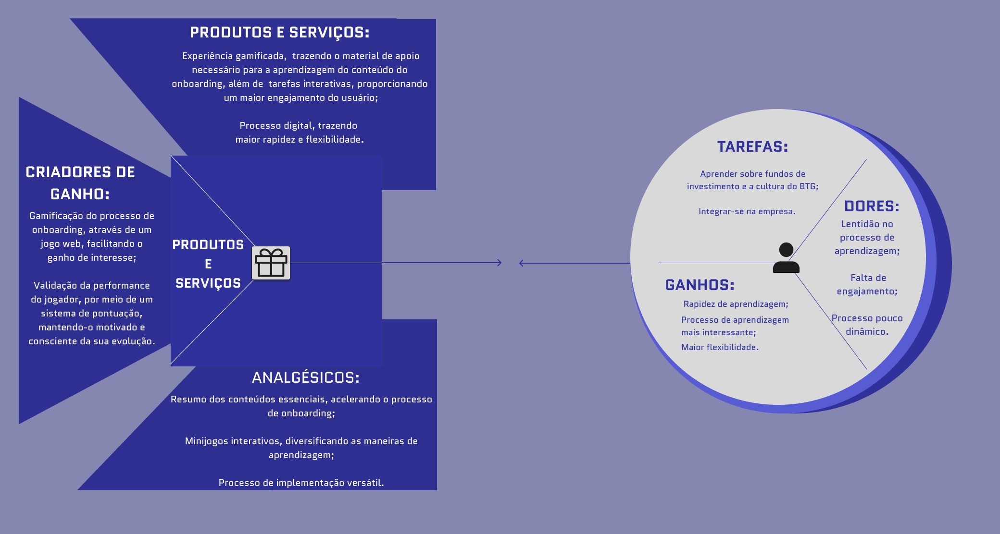

Produção autoral

#

Destacamos alguns aspectos do canvas, principalmente quanto às dores do cliente e os criadores de ganho da solução. O principal desafio apresentado pelo BTG Pactual envolve o atual processo de onboarding, que se mostra pouco dinâmico e atrativo. Dessa forma, os criadores de ganho que definimos buscam proporcionar uma experiência que, aliada aos analgésicos propostos, seja capaz de atender às expectativas do parceiro de projeto e esteja alinhada com a nossa solução.

Como temos 10 semanas de trabalho, a priorização das tarefas, dores e ganhos, conceito apresentado anteriormente, demonstra a sua importância. No caso de nosso projeto, o foco desejado pela empresa parceira está nas informações passadas para novos funcionários. Ou seja, o aspecto principal de nossa solução precisa estar alinhada com a transmissão de conteúdos. Por esse caminho, definimos a seção "Criadores de ganho", visto na figura 3, trazendo a nossa proposta de gamificação do processo de onboarding junto com a validação da performance do jogador, visando garantir que o mesmo compreendeu os conteúdos necessários, principal ponto desejado pelo parceiro.

### 1.1.5. Descrição da Solução Desenvolvida (sprint 4)

O jogo _Capital Downfall_ visa solucionar os problemas expostos pelo cliente em relação à falta de engajamento dos novos funcionários com o _onboarding_, à burocracia desse processo e à falta de dinamização na aprendizagem.  Diante disso, a solução proposta oferece uma experiência gamificada que transforma o _onboarding_ tradicional em um processo mais ágil, interativo e envolvente. Para agregar ainda mais valor à experiência do usuário, o jogo conta com um sistema de pontuação que permite que os jogadores acompanhem seu progresso e se mantenham motivados, materiais de apoio integrados que possibilitam o acesso rápido e fácil a conteúdos essenciais, sem a necessidade de sair da tela do jogo, e minigames interativos que reforçam o aprendizado de forma criativa e envolvente, tornando a assimilação do conteúdo mais eficiente.

### 1.1.6. Matriz de Riscos (sprint 4)

_Registre na matriz os riscos identificados no projeto, visando avaliar situações que possam representar ameaças e oportunidades, bem como os impactos relevantes sobre o projeto. Apresente os riscos, ressaltando, para cada um, impactos e probabilidades com plano de ação e respostas._

### 1.1.7. Objetivos, Metas e Indicadores (sprint 4)

_Definição de metas SMART (específicas, mensuráveis, alcançáveis, relevantes e temporais) para seu projeto, com indicadores claros para mensuração_

## 1.2. Requisitos do Projeto (sprints 1 e 2)

Durante a reunião com o parceiro do projeto foi possível definir uma série de requisitos que contemplam desde a estética até a mecânica do jogo.

Quadro 1: Requisitos do Projeto

**Quadro de requisitos**
\# | **Requisito**  
--- | ---
1 |O jogo será desenvolvido para Web, acessível através de um PC.
2 |O jogo terá uma câmera oblíqua que seguirá o jogador, garantindo visão ampla do ambiente.
3 |O jogador se movimentará pelo mapa utilizando as setas do teclado.
4 |O jogador poderá interagir com botões e menus na tela utilizando o botão esquerdo do mouse.
5 |A interação com terminais, computadores e outros elementos do cenário será realizada pressionando a tecla "espaço".
6 |As tasks estarão espalhadas por todo o escritório virtual, incentivando a exploração.
7 |O jogador poderá escolher a ordem em que deseja realizar as tasks.
8 |Se o jogador errar uma task, não poderá refazê-la, impactando o desempenho da empresa.
9 |Algumas interações abrirão menus de tarefas ou quizzes na tela, exigindo tomada de decisão ou conhecimento técnico.
10|O progresso do jogador será avaliado em tempo real com base no seu desempenho nas tasks.
11|No fim de cada fase, um jornal exibirá os impactos positivos ou negativos das decisões do jogador no banco.
12|O jogo terá níveis crescentes de dificuldade, exigindo mais atenção e estratégia a cada fase.
13|O jogador receberá moedas virtuais ao completar tarefas corretamente.
14|Conquistas serão desbloqueadas ao atingir certos marcos de progresso.
15|O jogador poderá gastar moedas para personalizar o seu personagem, adquirindo acessórios e itens cosméticos.

## 1.3. Público-alvo do Projeto (sprint 2)

O público-alvo consiste em um grupo de indivíduos com características em comum, tornando-os mais inclinados a consumir determinados produtos ou serviços oferecidos por uma empresa que os tem como foco (SEBRAE, [20--]).

Definir um público-alvo de forma estratégica garante uma vantagem competitiva, permitindo uma comunicação e um marketing mais eficazes, além de impulsionar as vendas. No entanto, uma definição muito ampla ou imprecisa pode gerar inconsistências, reforçando a importância de considerar aspectos como gênero, idade, localização, profissão e escolaridade ao traçar esse perfil (SEBRAE).

Para alinhar o projeto de forma assertiva, foi estabelecido um público-alvo específico. O jogo Capital Downfall é voltado para pessoas de qualquer gênero, raça e etnia, com idade acima de 18 anos, que trabalham como analistas de fundos de investimentos no banco BTG. São indivíduos que buscam compreender melhor os processos internos da empresa, mas que podem enfrentar dificuldades devido à sua complexidade.

Além disso, o jogo se destina a profissionais responsáveis, comprometidos com a diversidade e representatividade no ambiente corporativo, bem como engajados na busca por conchecimento.

Outro fator importante relacionado ao público-alvo é o conceito de **personas**, que representam perfis detalhados e humanizados do público ideal. Essas personas levam em conta não apenas informações objetivas, mas também aspectos subjetivos, como medos, desafios, motivações e aspirações que impulsionam o interesse por um produto ou serviço (SEBRAE).

Para garantir um jogo mais personalizado e voltado para experiências reais, foi definida uma persona que orientará o desenvolvimento da experiência oferecida.

### Persona do usuário:

- **Nome:** _Tiago Mendes_
- **Idade:** _24_
- **Gênero:** _Masculino_
- **Cargo:** _Analista de Fundos de Investimentos do BTG Pactual_

#### Características:

- Proativo
- Curioso
- Esforçado

#### Biografia:

Tiago Mendes é um analista de fundos de investimento recém-contratado para o BTG Pactual, nascido e criado em São Paulo. Possui graduação em Economia pela Universidade de São Paulo (USP) e pós-graduação em Gestão Financeira pela Fundação Getúlio Vargas (FGV). Destacou-se no gerenciamento de investimentos em diversos e-commerces antes de ser contratado pelo banco BTG, onde atualmente está realizando o processo de onboarding da empresa.

#### Dores:

- Falta de uma abordagem didática e prática para compreender os processos internos sobre fundos de investimento do banco BTG.
- Dificuldade em manter o foco e o engajamento ao longo de treinamentos tradicionais sobre conteúdos extensos e pouco didáticos.

#### Necessidades:

- Mecanismo que simplifique e promova o entendimento didático do processo de onboarding de fundos de investimentos do banco BTG.
- Treinamento mais divertido para manter sua atenção.

# 2. Visão Geral do Jogo (sprint 2)

## 2.1. Objetivos do Jogo (sprint 2)

Para concluir o jogo, o jogador deve avançar por quatro dias, cada um representando desafios progressivos dentro do ambiente corporativo do banco. No primeiro dia, ele inicia na hub principal do escritório e pode escolher a ordem das tarefas introdutórias, que abordam conceitos básicos e operações fundamentais do banco. Ao concluir todas as tarefas, um relatório em formato de jornal apresenta o impacto de suas decisões, determinando se pode prosseguir para o dia seguinte.

No segundo dia, as tarefas se tornam mais complexas, exigindo maior atenção aos detalhes e tomada de decisão estratégica. O jogador precisa lidar com desafios mais técnicos e gerenciar riscos operacionais. Ao final, novamente, o jornal avalia seu desempenho, e, caso tenha obtido um resultado satisfatório, ele avança para o próximo dia.

No terceiro dia, a crise financeira se intensifica e as tarefas ganham um nível de urgência maior. O jogador precisa gerenciar múltiplos problemas simultaneamente, tomando decisões que podem impactar diretamente o desempenho do banco. O relatório do jornal pode indicar estabilidade, recuperação parcial ou um cenário crítico, influenciando o desfecho da jornada.

No quarto e último dia, o jogador é levado a um ambiente de alta tensão, simulando uma verdadeira "sala de guerra", onde precisa tomar decisões rápidas e coordenar soluções para estabilizar o banco. As tarefas são ainda mais desafiadoras e exigem precisão para evitar o colapso financeiro. No final, o jornal apresenta o desfecho do jogo, que pode variar entre a recuperação total do banco, uma situação instável ou a falência definitiva.

## 2.2. Características do Jogo (sprint 2)

### 2.2.1. Gênero do Jogo (sprint 2)

Capital Downfall é um Role Playing Game(RPG) corporativo com elementos de simulação e estratégia. O jogador assume o papel de um analista de tecnologia de um banco e deve cumprir tarefas essenciais para manter o banco funcionando. A progressão ocorre por meio de decisões estratégicas, quizzes, resolução de desafios e mini-games, impactando diretamente o desempenho da empresa. Com um ambiente dinâmico e desafios progressivos, o jogo combina narrativa imersiva e aprendizado interativo, trazendo uma experiência única de gestão e tomada de decisões no mercado financeiro.

### 2.2.2. Plataforma do Jogo (sprint 2)

O jogo está sendo desenvolvido com a premissa de ser executado principalmente em computadores, sendo otimizado para essa plataforma. No entanto, ele também poderá ser acessado por meio de um link, o que possibilita que o jogo seja jogado em qualquer dispositivo com acesso à internet, como smartphones e tablets. Contudo, é importante ressaltar que a experiência foi projetada e ajustada com foco na interface e nas funcionalidades específicas para computadores. Portanto, embora o jogo seja acessível em diversas plataformas, a jogabilidade e a interação foram concebidas para proporcionar o melhor desempenho e usabilidade quando jogado em um computador.

### 2.2.3. Número de jogadores (sprint 2)

O jogo será projetado para ser jogado exclusivamente por um único jogador por vez, sem a implementação de modalidades multiplayer ou cooperativas. Cada sessão de jogo será uma experiência individual, focada no progresso e na conclusão das tarefas atribuídas ao jogador. Dessa forma, a dinâmica de jogo será centrada na imersão de um único participante, com a barra de tarefas servindo como indicador do avanço e da conclusão das fases. A ausência de modo multiplayer visa proporcionar uma experiência mais introspectiva e desafiadora, em que o jogador assume o papel exclusivo de progredir e conquistar vitórias ao completar suas tarefas, dentro de um ambiente visualmente envolvente e estruturado com a estética de pixel art.

### 2.2.4. Títulos semelhantes e inspirações (sprint 2)

Foram selecionados dois jogos como referência. O primeiro é Among Us, do qual será incorporada a mecânica de progressão de tarefas. No Among Us, quando um jogador completa uma "task", a barra de tarefas aumenta. Quando essa barra atinge o máximo, a fase é concluída, resultando na vitória do jogador. A segunda referência é Stardew Valley, porém, não pela mecânica do jogo, mas pela estética em pixel art, que será adotada no design visual. A combinação dessas influências visa criar uma dinâmica onde, por um lado, o progresso das tarefas traz uma sensação de colaboração, enquanto, por outro, a estética em pixel art oferece um ambiente visualmente acolhedor e nostálgico, contribuindo para uma experiência única e imersiva para os jogadores.

### 2.2.5. Tempo estimado de jogo (sprint 5)

O jogo pode ser concluído entre 15 e 20 minutos passando por todas as fases.

# 3. Game Design (sprints 2 e 3)

## 3.1. Enredo do Jogo (sprints 2 e 3)

O enredo do nosso jogo se baseia em um problema financeiro em um banco. Para resolver essa crise, o banco decidiu contratar um analista. No jogo, você pode escolher entre quatro personagens, e aquele que você selecionar será o profissional contratado para enfrentar o desafio. O arco narrativo do jogo será apresentado ao jogador logo no início, será nosso texto inicial que irá introduzir o jogador a uma trama envolvente e cheia de decisões críticas.

“Seja muito bem-vindo! Na crise atual do mundo financeiro, precisamos de sua ajuda para garantir o crescimento da empresa. Ao redor do nosso escritório, estão 3 tarefas para você realizar. Elas estão demarcadas por pontos de exclamação.

Movimente-se com as setinhas do teclado, e interaja com essas tarefas utilizando a barra de espaço.
Contamos com você!”

O objetivo do texto inicial é introduzir o jogador nos módulos que se seguem. O arco de conflito do jogo é representado pelos módulos, que funcionam como mini games projetados para testar as habilidades do jogador, desafiando-o a resolver problemas financeiros. Já o arco de resolução se concentra na "sala de guerra", um ambiente que, embora semelhante aos módulos, eleva a dificuldade e intensifica o clima de tensão, simulando uma situação real e crítica. Se o jogador conseguir superar esse desafio final, ele concluirá o jogo, encerrando o arco de resolução com sucesso.

## 3.2. Personagens (sprints 2 e 3)

### 3.2.1. Controláveis

Todos os personagens do jogo deveriam ser inclusivos para cumprir o objetivo de tornar o jogador mais imerso, pois ele pode se identificar mais com a opção de personagem escolhida.

#

  
Figura 1: Mark

  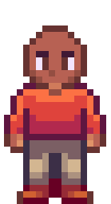 
  
Produção autoral

  

#

  
Figura 2: Margaret

  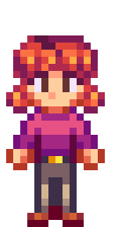
  
Produção autoral

#

  
Figura 3: Steve

  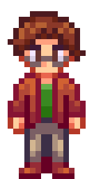
  
Produção autoral

#

  
Figura 4: Mary

  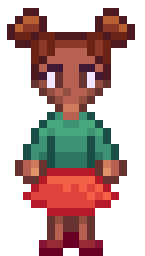
  
Produção autoral

#

### 3.2.2. Non-Playable Characters (NPC)

_\<opcional\> Se existirem coadjuvantes ou vilões, aqui é o local para descrevê-los e ilustrá-los. Utilize listas ou tabelas para organizar esta seção. Caso utilize material de terceiros em licença Creative Commons, não deixe de citar os autores/fontes. Caso não existam NPCs, remova esta seção._

### 3.2.3. Diversidade e Representatividade dos Personagens

O primeiro personagem do nosso jogo é o Mark, um analista júnior de 25 anos com experiência prévia em estágios no setor financeiro. Acreditamos que o Mark está totalmente alinhado com o nosso público-alvo, que são os analistas. Além disso, ele representa bem a realidade da sociedade brasileira, já que é um homem negro, jovem e no início de sua carreira.Segundo o IBGE, no Brasil, 20,6 milhões de pessoas se declaram como pretas, compondo uma porcentagem de 10,2% da população total, indicando a significância de representação do grupo. As escolhas feitas para a construção do Mark foram muito bem pensadas e terão um impacto positivo na questão da representatividade.

O segundo personagem é a Margaret, que tem uma carreira consolidada em contabilidade e planejamento financeiro, mas há quatro anos decidiu migrar para a área de fundos de investimento, onde se estabeleceu como uma analista experiente. A Margaret, apesar de sua trajetória inicial em outro setor, se encaixa perfeitamente no nosso público-alvo, já que possui quatro anos de experiência como analista. Em termos de representação da realidade brasileira, a Margaret traz a perspectiva de uma mulher experiente em sua área, mas que busca uma transição de carreira, mantendo-se dentro do nosso foco principal.

O terceiro personagem é o Steve, um jovem que sempre teve uma mente inquieta e apaixonada por números. Cresceu em um bairro simples, onde poucos falavam sobre tecnologia e investimentos, mas ele via neles um caminho para transformar sua vida. Aprendeu programação sozinho e logo percebeu o impacto que a tecnologia poderia ter no mercado financeiro. Mergulhou nos estudos, especializou-se em fundos de investimento e desenvolveu soluções inovadoras para análise de dados. Steve também enfrentou dificuldades no decorrer da vida, por causa de sua orientação sexual, porém encontrou na empresa um local seguro e acolhedor.

O quarto personagem é a Mary, uma cientista de dados com experiência em machine learning e inteligência artificial, que recentemente decidiu migrar para o setor financeiro. A Mary também está alinhada com o impacto que esperamos gerar, pois, ao contrário do Mark, ela não tem uma trajetória prévia no setor financeiro. A Mary, diferente do Mark, já tem uma carreira consolidada, mas isso não diminui sua representatividade. Pelo contrário, como uma mulher negra em uma posição de destaque, ela reforça a importância da representatividade e deve gerar um impacto significativo nesse aspecto.

Esses quatro personagens, com suas diferentes trajetórias e perfis, refletem a diversidade e a complexidade da sociedade brasileira, ao mesmo tempo em que se alinham com o público-alvo do nosso jogo. Essa abordagem trará um impacto positivo tanto em termos de engajamento quanto de representatividade.

## 3.3. Mundo do jogo (sprints 2 e 3)

### 3.3.1. Locações Principais e/ou Mapas (sprints 2 e 3)

O jogo será ambientado no escritório de um grande banco. O mapa consiste em uma sala principal maior no centro, mais dez salas menores que simulam o ambiente empresarial bancário. No início do jogo, o jogador poderá se movimentar pelo escritório e encontrará alguns computadores com os quais poderá interagir. Nesses dispositivos, estarão localizados os minigames do jogo.

#

    
Figura 1: Mapa do jogo

    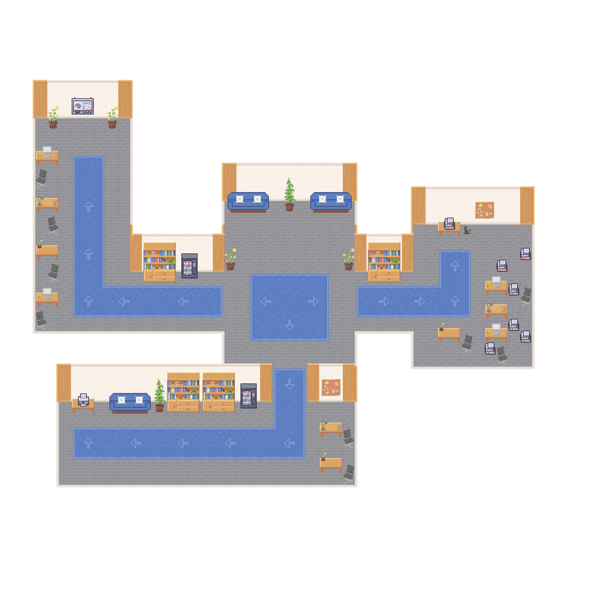 
    
Produção autoral

#

No início do jogo, o jogador poderá se movimentar pelo escritório e encontrará terminais com os quais poderá interagir. Nesses dispositivos, estarão localizados os minigames do jogo. O jogador terá total liberdade para se movimentar e escolher a ordem em que deseja realizar os minigames disponíveis.

#

    
Figura 2: Exemplo de objeto interativo, marcado pela exclamação

    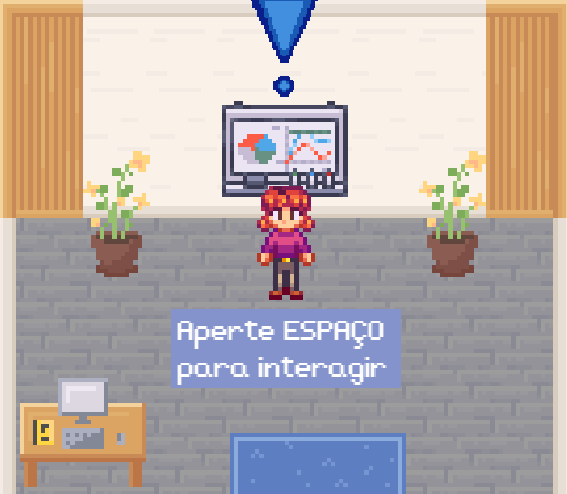 
    
Produção autoral

#

O jogo possuirá três fases, e cada fase terá três minigames que abordarão algum dos assuntos solicitados pelo BTG Pactual, além de um quiz ao final, que contemplará todo o conteúdo da fase. Também haverá uma fase 4, que simulará o contexto de pressão de uma sala de guerra, em que todos os conteúdos serão abordados de uma só vez e haverá um limite de tempo. A tabela a seguir ilustra e explica os três minigames implementados na primeira fase do jogo:

| Imagem do minigame                                      | Resumo                                                                                                                                                                        |
| ------------------------------------------------------- | ----------------------------------------------------------------------------------------------------------------------------------------------------------------------------- |
| 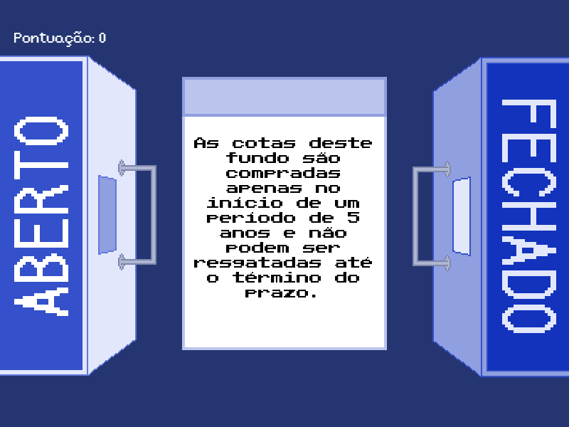 | O jogador deve analisar um card contendo informações sobre um fundo e arrastá-lo, com o mouse, para a gaveta correta — "Aberto" ou "Fechado" — com base em sua interpretação. |
| 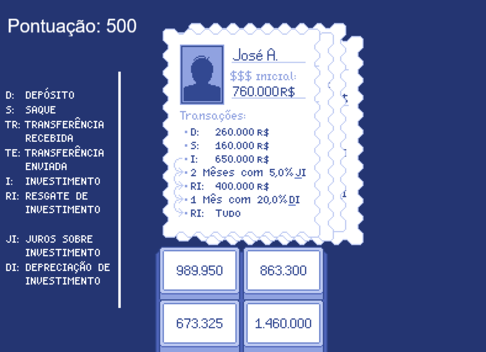 | O jogador deve realizar cálculos financeiros.                                                                                                                                 |
| 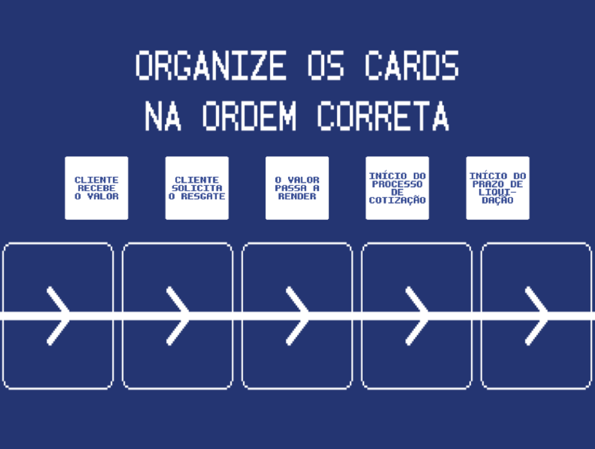 | O jogador deve ordenar corretamente as etapas do resgate em um fundo de investimento.                                                                                         |
| 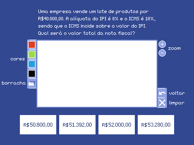 | O jogador deve ordenar responder questões sobre impostos diversos                                                                                                             |
| 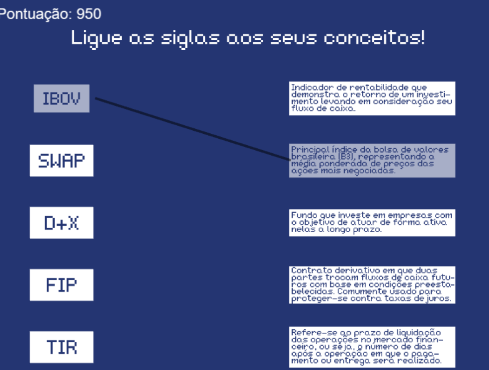 | O jogador deve ligar termos e definições de conceitos financeiros.                                                                                                            |
| 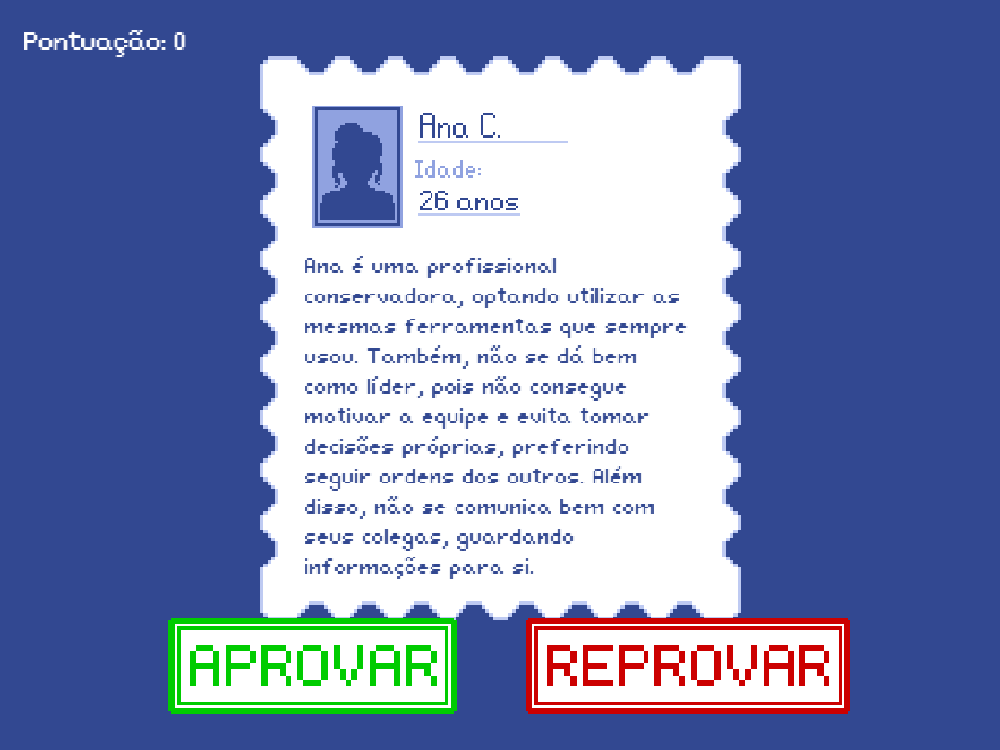 | O jogador deve avaliar perfis de candidatos.                                                                                                                                  |

### 3.3.2. Navegação pelo mundo (Sprints 2 e 3)

A navegação no jogo é simples e intuitiva, permitindo que o jogador explore o ambiente do escritório de um grande banco e interaja com os elementos disponíveis.

#### Movimentação do Personagem

- O jogador pode movimentar o personagem utilizando as setas do teclado (`↑ ↓ → ←`).
- A movimentação é livre, permitindo que o jogador explore todas as áreas do escritório desde o início.

#### Interação com os Objetos

- Ao se aproximar de um objeto interativo, um ícone de exclamação aparecerá sobre ele, indicando que o jogador pode interagir.
- Para acessar os minigames, o jogador deve pressionar a tecla **espaço** (`Space`).
- Ao interagir, o jogador será redirecionado para um dos minigames disponíveis no jogo.

#### Acesso aos Minigames

- Dentro dos minigames, o jogador utilizará o **mouse** para realizar as ações necessárias.

  - **Minigame 1:** O jogador deve arrastar cards para as gavetas corretas.
  - **Minigame 2:** O jogador deve realizar cálculos financeiros.
  - **Minigame 3:** O jogador deve ordenar corretamente as etapas do resgate.
  - **Minigame 4:** O jogador deve responder questões sobre impostos.
  - **Minigame 5:** O jogador deve ligar nomes e definições de conceitos financeiros.
  - **Minigame 6:** O jogador deve ordenar avaliar perfis de candidatos.

Ao concluir cada minigame, o jogador pode retornar ao escritório e escolher um novo desafio.

### 3.3.3. Condições climáticas e temporais (sprints 2 e 3)

O jogo utiliza uma progressão baseada em dias, onde cada fase representa um dia de trabalho no escritório do banco. O jogador pode completar os desafios no seu próprio ritmo dentro de cada fase. Ao concluir todos os 3 minigames e o quiz final de cada fase, o jogador receberá um relatório de desempenho, que destaca seu progresso e acertos.

Durante as três primeiras fases, não há limite de tempo para a conclusão dos minigames e quizzes. Entretanto, na fase 4, que irá simular uma sala de guerra, todos os conteúdos das fases anteriores serão abordados de forma combinada. Nessa fase final, haverá um limite de tempo, desafiando o jogador a aplicar rapidamente seus conhecimentos sob pressão.

### 3.3.4. Concept Art (sprint 2)

#

    
Figura 1: Tela inicial do jogo, apresentando a opção para o jogador iniciar uma nova partida.

    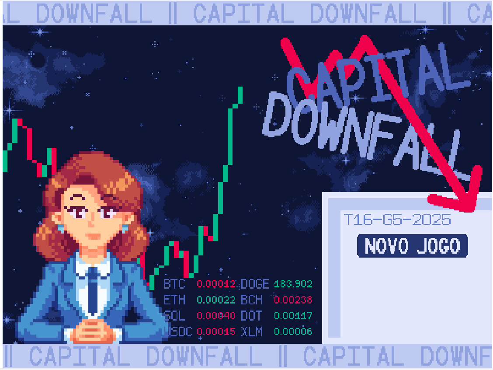 
    
Produção autoral

#

  
Figura 2: Visão do mapa inicial do jogo, destacando o ambiente do escritório. No canto superior direito, um computador com um ícone de exclamação indica que o jogador pode interagir com ele.

  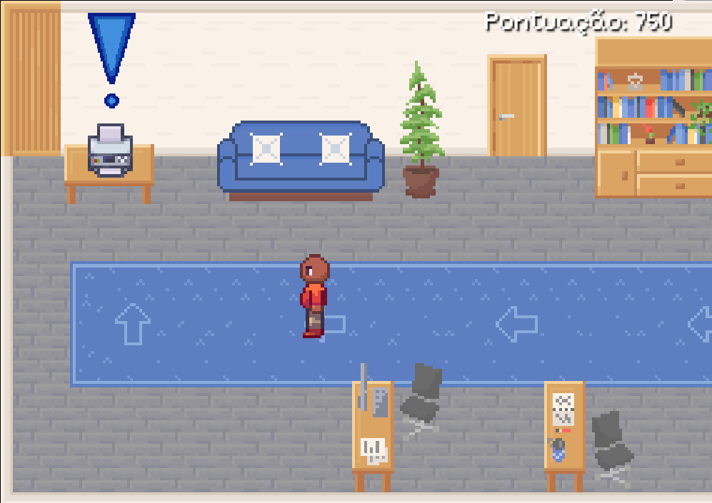 
  
Produção autoral

#

  
Figura 3: Exemplo de material de apoio disponibilizado para o jogador antes de cada fase.

  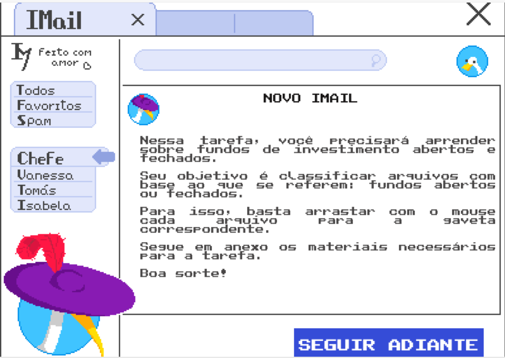 
  
Produção autoral

#

    
Figura 4: Minijogo sobre diferenciação de fundos de investimento.

    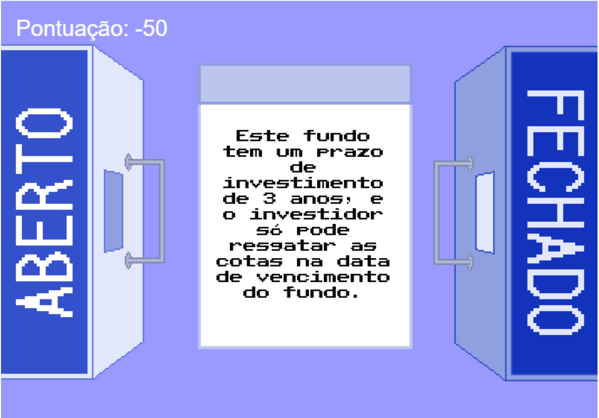 
    
Produção autoral

#

    
Figura 5: Minijogo sobre resgate em fundos de investimento.

     
    
Produção autoral

#

    
Figura 6: Minijogo sobre monitoramento de transações bancárias.

    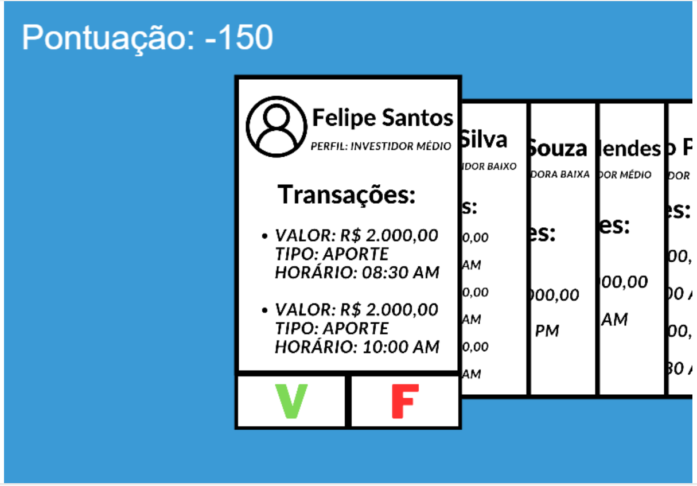 
    
Produção autoral

#

  
Figura 7: Tela exibida ao final de um minijogo, apresentando a pontuação final do jogador.

   
  
Produção autoral

#

    
Figura 8: Concept art dos personagens Steve e Mary.

    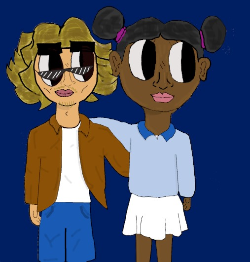 
    
Produção autoral

#

    
Figura 9: Concept art do menu inicial.

    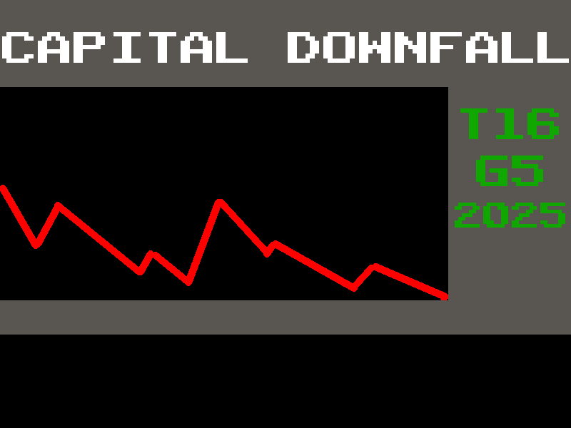 
    
Produção autoral

#

### 3.3.5. Trilha sonora (sprint 4)

_Descreva a trilha sonora do jogo, indicando quais músicas serão utilizadas no mundo e nas fases. Utilize listas ou tabelas para organizar esta seção. Caso utilize material de terceiros em licença Creative Commons, não deixe de citar os autores/fontes._

_Exemplo de tabela_
\# | titulo | ocorrência | autoria
--- | --- | --- | ---
1 | tema de abertura | tela de início | própria
2 | tema de combate | cena de combate com inimigos comuns | Hans Zimmer
3 | ...

## 3.5. Gameflow (Diagrama de cenas) (sprint 2)

A trajetória do usuário em nosso jogo pode ser representada por meio do diagrama a seguir, dividido em seções. As setas indicam as conexões entre as cenas, enquanto as linhas tracejadas buscam explicar essas conexões. Cada quadro representa uma cena, contendo sua classe, atributos e métodos, além de uma pequena explicação e imagem representativa.

#

  
Figura 1: Quadro 1

    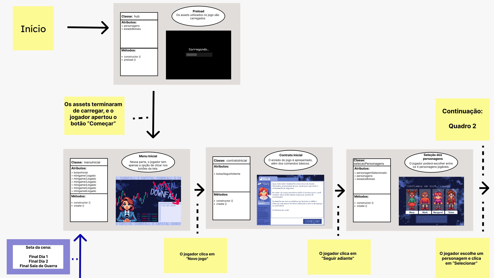 
    
Produção autoral

#

  
Figura 2: Quadro 2

    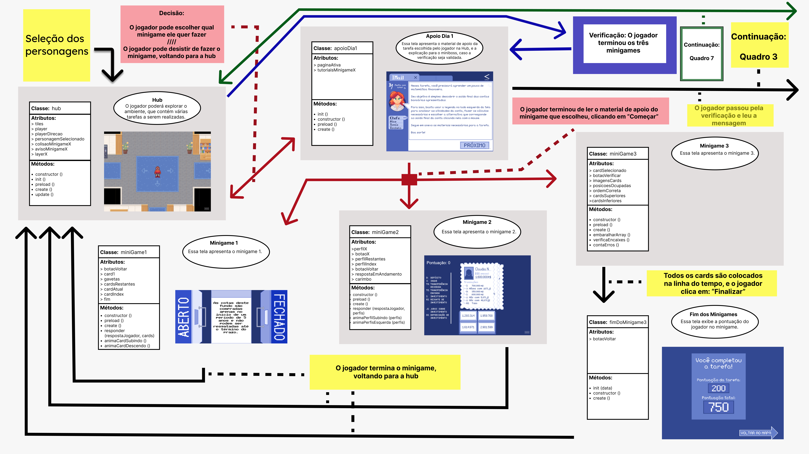 
    
Produção autoral

#

  
Figura 3: Quadro 3

    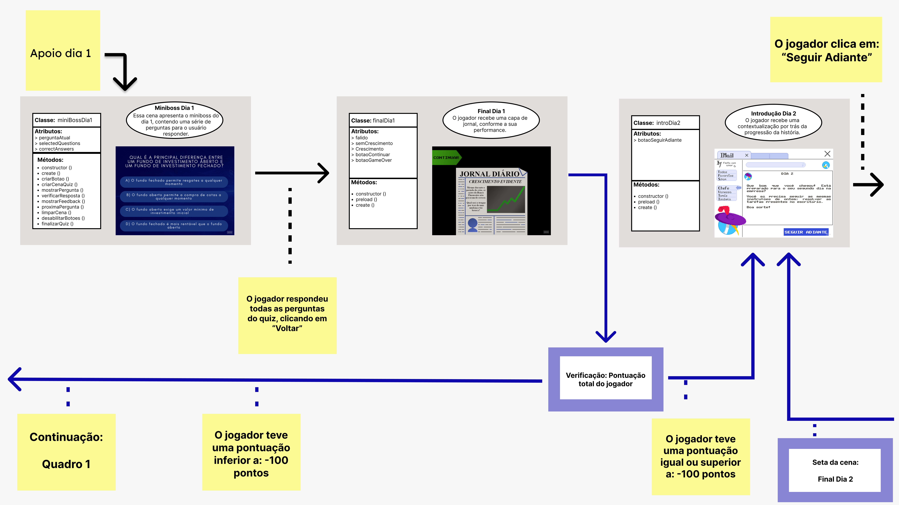 
    
Produção autoral

#

  
Figura 4: Quadro 4

    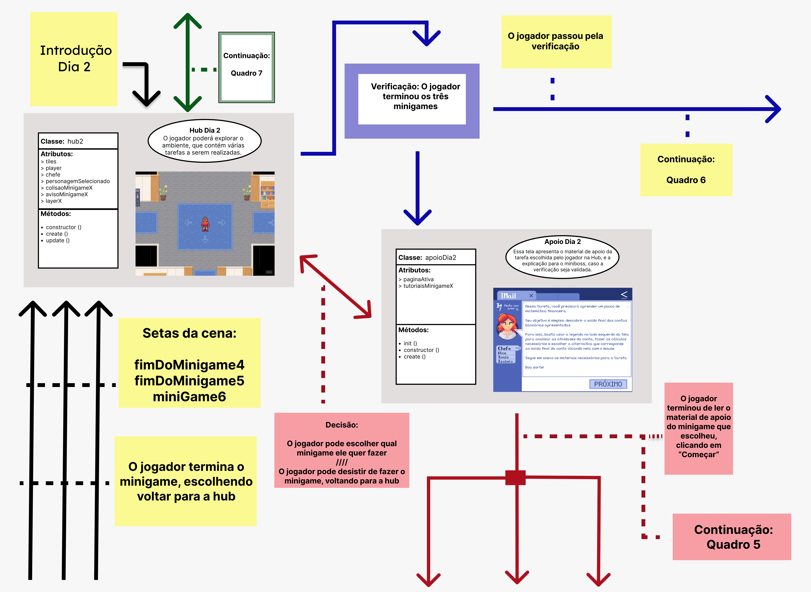 
    
Produção autoral

#

  
Figura 5: Quadro 5

    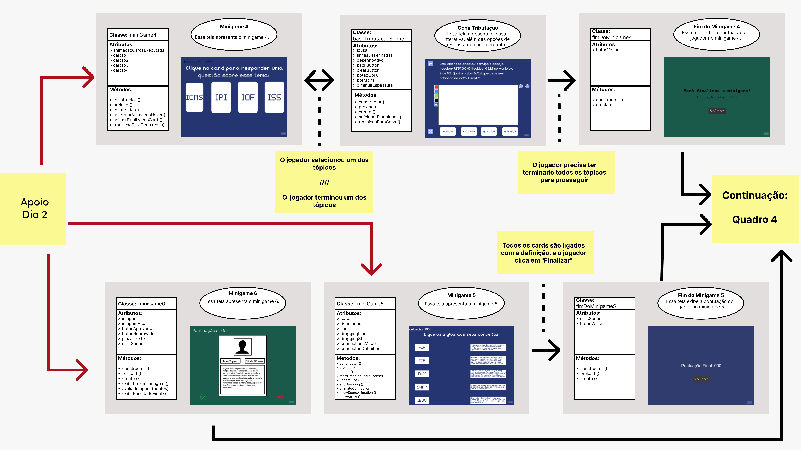 
    
Produção autoral

#

  
Figura 6: Quadro 6

    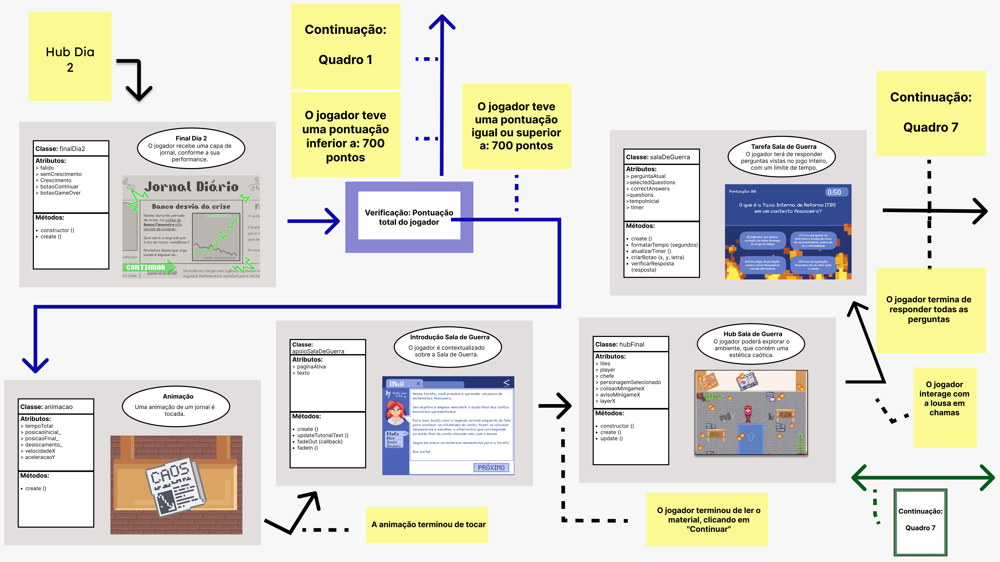 
    
Produção autoral

#

  
Figura 7: Quadro 7

    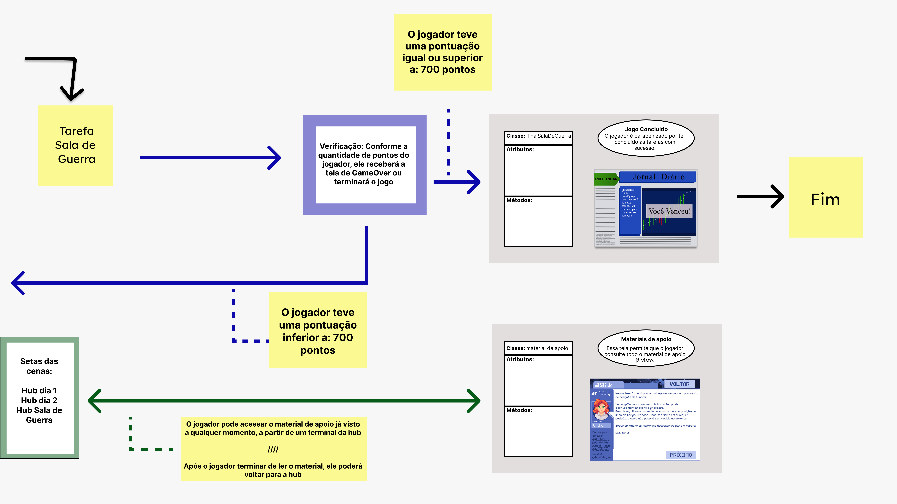 
    
Produção autoral

#

## 3.6. Regras do jogo (sprint 3)

Após selecionar o personagem, o jogador é conduzido à hub principal do jogo. O objetivo central é guiá-lo através de módulos, cada um composto por três minigames e um miniboss. Durante a jornada, o jogador encontra diversas tarefas espalhadas pelo mapa, podendo selecioná-las para avançar nas fases.

Os minigames possuem uma jogabilidade focada em questionários, sempre acompanhados de um texto introdutório que orienta o jogador e disponibiliza conhecimento sobre o desafio a ser enfrentado. Eles estão estrategicamente distribuídos pelo mapa, contribuindo para a dinâmica do jogo. Caso o jogador consiga superar os três minigames de um módulo, ele ganha acesso ao miniboss, que representa um desafio de revisão para a fixação do conteúdo, antes de avançar para o próximo módulo.

Esse ciclo se repete ao longo dos módulos. É importante destacar que cada tarefa pode ser realizada apenas uma vez. Desse modo, uma vez concluída, não há como refazê-la, garantindo ao jogador apenas uma chance para cada desafio.

## 3.7. Mecânicas do jogo (sprint 3)

**_Controles e Interação_**

O jogo é um 2D interativo, utilizando mouse/touchpad, setas do teclado para movimentação e a barra de espaço para interações.

**_Mecanismos e Funcionamento_**

**Mouse ou Touchpad**

(Minigame 1) Botão esquerdo + arrastar: Define se um fundo é aberto ou fechado ao reorganizar os _cards_.

(Mnigame 2) Botão esquerdo: Seleciona a resposta que indica o saldo resultante.

(Minigame 3) Botão esquerdo + arrastar: Coloca os \_cards\_\_ nos seus respectivos lugares na linha do tempo.

(Minigame 4) Botão esquerdo + arrastar: Seleciona a questão do imposto, rascunha a resposta na lousa e seleciona o resultado da questão.

(Minigame 5) Botão esquerdo + arrastar: Liga os termos e as definições de conteúdos-chave do mundo financeiro

(Minigame 6) Botão esquerdo: Seleciona se um candidato condiz com o perfil desejado.

**Setas do Teclado (Exploração do Mapa)**

Seta para a direita → Move o personagem para a direita no mapa.

Seta para a esquerda ← Move o personagem para a esquerda no mapa.

Seta para cima ↑ Move o personagem para trás no mapa (navegação em profundidade).

Seta para baixo ↓ Move o personagem para frente no mapa.

**Barra de Espaço (Interação)**

A barra de espaço permite que o jogador interaja, na _hub_, com objetos demarcados com um ponto de exclamação azul.

## 3.8. Implementação Matemática de Animação/Movimento (sprint 3)

_Descreva aqui a função que implementa a movimentação/animação de personagens ou elementos gráficos no seu jogo. Sua função deve se basear em alguma formulação matemática (e.g. fórmula de aceleração). A explicação do funcionamento desta função deve conter notação matemática formal de fórmulas/equações. Se necessário, crie subseções para sua descrição._

Antes da fase final do jogo, foi implementada uma animação de movimento em um elemento gráfico: um jornal que 'entra' na tela vindo de fora, gira e cai sobre uma mesa. O movimento ocorre simultaneamente nos eixos x e y, sendo o **eixo x** regido por um **Movimento Uniforme (MU)** e o **eixo y** por um **Movimento Uniformemente Variado (MUV)**, com velocidade inicial nula.

Para garantir uma animação realista e fluida, definimos os seguintes parâmetros:

- Posição inicial do elemento gráfico: (-32 px; 100 px);

- Posição final do elemento gráfico: (500 px; 550 px);

- Tempo total da animação: 1,5 segundos.

A seguir, apresentamos as equações matemáticas utilizadas para descrever o movimento do jornal ao longo do tempo.

---

### 3.8.1. Função matemática que representa o valor da velocidade no eixo x

Conforme Halliday, Resnick e Walker (2023) para se determinar a velocidade em um eixo com **Movimento Uniforme (MU)** em um instante t, usa-se a equação:

$V_x = \frac{\Delta S}{\Delta t} = \frac{X_f - X_i}{\Delta t}$ 

Onde:
- $V_x$ é a velocidade do elemento gráfico no eixo x;
- $\Delta S_x$ representa a variação da posição no eixo x, ou seja, $X_f - X_i$;
- $\Delta t$ corresponde a variação do tempo;
- $X_f$ é a posição final do elemento gráfico no eixo x;
- $X_i$ é a posição inicial do elemento gráfico no eixo x.

Substituindo os valores com base nos parâmetros anteriormente definidos:

$V_x = \frac{500 - (-32)}{1,5} = \frac{500 + 32}{1,5} = \frac{532}{1,5} \approx 354,67 \text{ px/s}$

Como no MU a aceleração é nula, a velocidade permanece constante e não depende do tempo t. Assim, a velocidade no eixo x será sempre igual à 354,67 px/s (pixels por segundo) considerando os valores escolhidos.

### 3.8.2. Função matemática que representa a coordenada no eixo x

Ainda segundo Halliday, Resnick e Walker (2023), para se definir a posição de uma partícula em um eixo com **Movimento Uniforme (MU)**, usa-se a equação:

$x(t) = x_0 + v_x \cdot t$

Onde:  
- $x(t)$ representa a posição do elemento gráfico no eixo x no instante $t$;  
- $x_0$ é a posição inicial do elemento gráfico no eixo x;  
- $v_x$ é a velocidade no eixo x (constante no MU);  
- $t$ é o tempo decorrido desde o início do movimento.  

Substituindo os valores definidos anteriormente:

$x(t) = (-32) + (354,67) \cdot t$

Ou seja, a posição do elemento gráfico no eixo x varia linearmente ao longo do tempo, aumentando a uma taxa constante de **354,67 px/s**, conforme esperado para um **Movimento Uniforme (MU)**.

### 3.8.3. Função matemática que representa a aceleração no eixo y

De acordo com Halliday, Resnick e Walker (2023), para determinar a aceleração em um eixo com **Movimento Uniformemente Variado (MUV)** podemos utilizar a **equação de Torricelli**:

$V_f^2 = V_0^2 + 2 \cdot a_y \cdot \Delta S$

Nosso objetivo é isolar a aceleração $a_y$. 

$V_f^2 - V_0^2 = 2 \cdot a_y \cdot \Delta S$

$a_y = \frac{V_f^2 - V_0^2}{2 \cdot \Delta S}$

Agora, substituímos os valores previamente definidos:  
- $V_f = 550 \text{ px/s}$
- $V_0 = 0 \text{ px/s}$  
- $\Delta S = Y_f - Y_i = 550 - 100 = 450 px$  

$a_y = \frac{550^2 - 0^2}{2 \cdot 450}$

$a_y = \frac{302500}{900}$

$a_y \approx 336,1 \text{ px/s}^2$

Assim, a aceleração no eixo y arredondada é aproximadamente **336,1 px/s²** (pixels por segundo ao quadrado) considerando os valores escolhidos para os parâmetros.

### 3.8.4. Função matemática que representa a velocidade no eixo y

Ainda segundo Halliday, Resnick e Walker (2023), para se determinar a velocidade em um instante $t$ em um eixo com **Movimento Uniformemente Variado (MUV)**, basta utilizar a equação:

$V_y = V_0 + a_y \cdot t$

Onde:
- $V_y$ representa a velocidade do elemento gráfico no eixo y no instante $t$;
- $V_0$ é a velocidade inicial no eixo y;
- $a_y$ é a aceleração no eixo y;
- $t$ é o tempo decorrido desde o início do movimento.

Substituindo os valores previamente definidos:

$V_y = 0 + (336,1 \cdot t)$

$V_y = 336,1 \cdot t$

Dessa forma, a velocidade do elemento gráfico no eixo y aumenta linearmente ao longo do tempo, conforme esperado para um **Movimento Uniformemente Variado (MUV)**.

### 3.8.5. Função matemática que representa a coordenada no eixo y 

Conforme Halliday, Resnick e Walker (2023), para se determinar a coordenada em um eixo com **Movimento Uniformemente Variado (MUV)** em um instante $t$, usa-se a equação:

$y(t) = y_0 + v_{0y} \cdot t + \frac{1}{2} a_y \cdot t^2$

Onde:
- $y(t)$ representa a posição do elemento gráfico no eixo y no instante $t$;
- $y_0$ é a posição inicial no eixo y;
- $v_{0y}$ é a velocidade inicial no eixo y (nula neste caso);
- $a_y$ é a aceleração no eixo y;
- $t$ é o tempo decorrido desde o início do movimento.

Substituindo os valores previamente definidos:

$y(t) = 100 + 0 \cdot t + \frac{1}{2} \cdot 336,1 \cdot t^2$

$y(t) = 100 + 168,05 \cdot t^2$

Dessa forma, a posição do elemento gráfico no eixo y segue uma curva parabólica ao longo do tempo, caracterizando um **Movimento Uniformemente Variado (MUV)**.

# 4. Desenvolvimento do Jogo

## 4.1. Desenvolvimento preliminar do jogo (sprint 1)

Para o desenvolvimento do nosso projeto, o método _Scrum_ foi utilizado. Nele, o desenvolvimento é divido em _sprints_, cada uma com 2 semanas de duração. Cada _sprint_ é essencial para o progresso do projeto, o primeiro deles sendo o mais significante, já que é o período na qual grupo estipulou o escopo do projeto, além de escolher a direção a ser seguida. Nessa etapa também foi definido que a linguagem de programação utilizada seria o JavaScript, unido ao framework Phaser.

De acordo com as mêcanicas definidas pela equipe, a tela escolhida para ser a primeira a ser desenvolvida foi a da interface do computador. Nela, o jogador recebe o contexto por trás da narrativa apresentada, além de ser o local que precede os minijogos. Ela precisava capturar a essência do projeto, sendo capaz de comunicar para o usuário o estilo de ensino abordado. Na parte do código, uma função de tempo foi utilizada, como forma de evitar que o jogador apenas pule a cena sem ao menos a ter lido. Além disso, um botão foi posicionado no canto inferior direito da tela que, ao ser clickado, mudaria para a cena seguinte.

A criação dessa tela não tem apenas uma importância técnica, mas também temática. Ela é essencial para a validação do progresso do projeto, permitindo que o grupo consiga entender se está seguindo o caminho correto de desenvolvimento, conforme o desejo da empresa parceira. No método _Scrum_, a constante incrementação dos entregáveis é uma de suas características marcantes, e essa cena também seguirá esses passos, sendo melhorada conforme o _feedback_ recebido.

#

Figura 1: Cena da interface do computador:

Produção autoral

#

Figura 2: Parte do código referente à cena:

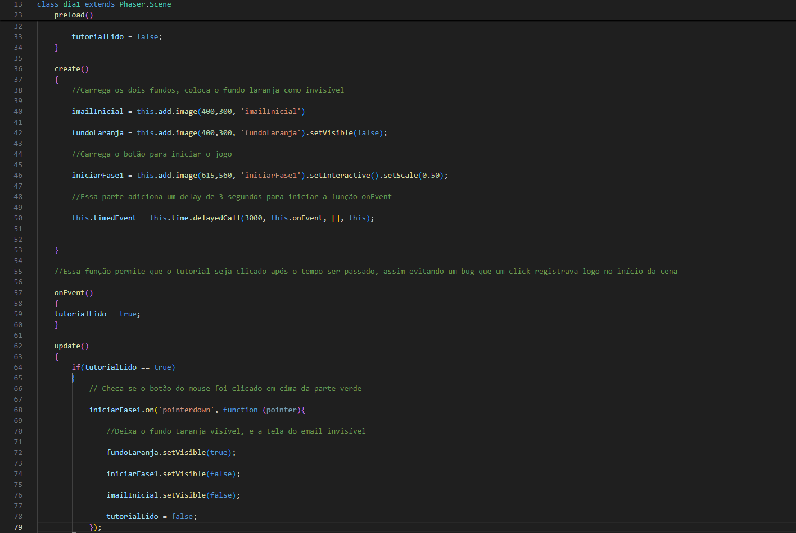

Produção autoral

#

A outra cena escolhida para ser desenvolvida pelo grupo foi a da hub inicial. Isso se deve ao fato da mesma permitir o teste de algumas das tecnologias que serão utilizadas futuramente no projeto, com destaque para os _Tilesets_ e _Tilemaps_. Um _Tileset_ é um conjunto de imagens do mesmo tamanho, denominadas de _Tiles_, que servem como "blocos de construção" para cenas, permitindo que elas sejam criadas de maneira rápida e eficiente. Um _Tilemap_ é um arquivo que armazena as informações do posicionamento das _Tiles_ em uma cena, trazendo informações como colisões e camadas.

Além disso, a movimentação simples de um personagem foi implementada, se utilizando das "setinhas" para poder se deslocar pelo mapa. Interações simples com objetos também foi adicionada, permitindo que o jogador utilize da tecla "espaço" para realizar uma ação em determinado objeto.

#

Figura 3: Exemplo do _Tileset_ utilizado:

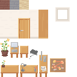

Produção autoral

#

Figura 4: Parte do código referente à cena:

Produção autoral

#

De forma geral, a _sprint_ 1 trouxe diversos desafios, porém também trouxe uma maior familiarização com o projeto e com as ferramentas a serem utilizadas. Um obstáculo significativo no decorrer do desenvolvimento foi a utilização do _Tilemap_, que envolve a referência de múltiplos outros arquivos e variáveis. A ideia central do projeto também foi alterada algumas vezes, para melhor condizer com os desejos da empresa parceira.

Para os próximos passos, pretendemos começar a implementação do conteúdo técnico requisitado pelo parceiro, além de iniciar a criação dos minijogos em si.

## 4.2. Desenvolvimento básico do jogo (sprint 2)

Para a _sprint_ 2, avançamos no desenvolvimento das cenas do jogo. Focamos nas cenas que compõe o primeiro dia dentro do jogo, assim permitindo que a nossa entrega capture a ideia geral por traz do nosso planejamento.

Assim, nessa _sprint_, desenvolvemos três _minigames_. Cada um deles apresentam mecânicas diferentes, abordando áreas do conteúdo requisitadas pelo parceiro do projeto.

O primeiro deles é sobre fundos de investimento. Nele, o jogador precisa classificar arquivos em duas categorias: fundos abertos e fundos fechados. Para isso, basta clicar no arquivo com o botão esquerdo do mouse, e arrastá-lo para a classificação correta. No topo da tela, a pontuação vai sendo atualizada em tempo real.

#

Figura 1: _Gameplay_ do _minigame 1:

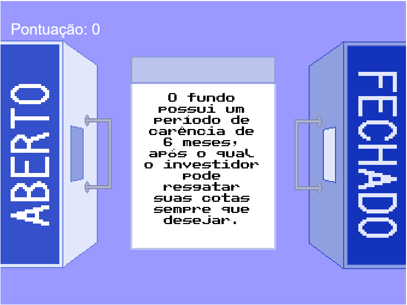

Produção autoral

#

O segundo _minigame_ aborda a validação de transações no mercado. Cabe ao usuário classificar diferentes registros de transações de investidores, levando em conta discrepâncias nos dados. Em cada arquivo, há dois botões, permitindo a classificação do material. Da mesma forma do primeiro _minigame_, a pontuação é atualizada conforme o seu progresso.

#

Figura 2: _Gameplay_ do _minigame 2:

Produção autoral

#

O terceiro _minigame_ retrata os conteúdos por traz do processo de resgate da cotação. O jogador precisa colocar, em uma linha do tempo, a ordem dos acontecimentos em um resgate típico de valores. Isso pode ser feito ao clicar em um _card_ na parte superior da tela, depois clicando na sua posição correspondente na parte inferior. Após todos os _cards_ serem posicionados, basta clicar na seta que aparece na tela, para receber a sua pontuação.

#

Figura 3: _Gameplay_ do _minigame 3:

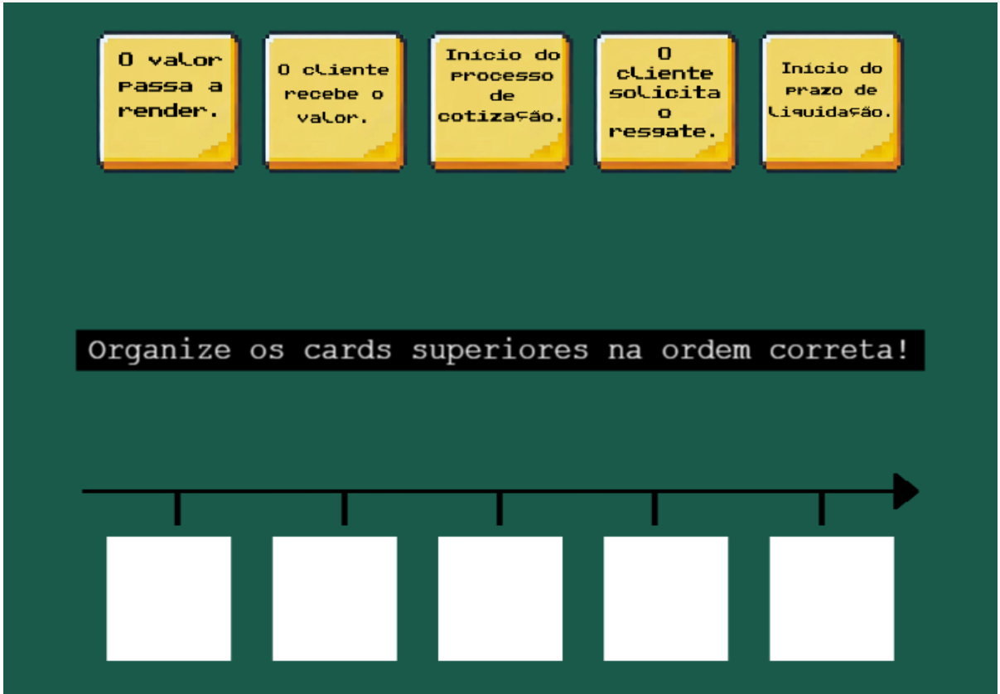

Produção autoral

#

É importante destacar que cada um desses _minigames_ contém um material de apoio específico, indicando a maneira correta de jogar, além das informações necessárias para compreender o conteúdo por traz do minijogo.

#

Figura 4: Exemplo do material de apoio do _minigame_ 1:

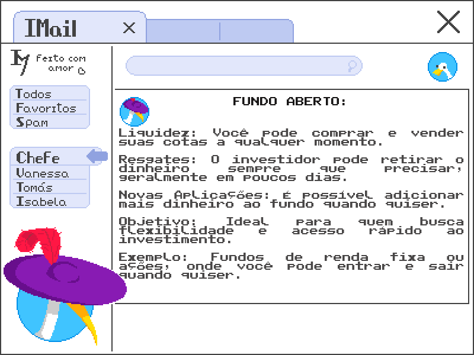

Produção autoral

#

A escolha desses _minigames_ específicos para a entrega dessa _sprint_ se deve ao fato de eles não serem extremamente complexos, tanto no quesito da programação quanto para a experiência do usuário. Assim, eles servem como uma forma de introdução para o _gameplay loop_ do nosso jogo.

#

Figura 5: Exemplo do código do _minigame_ 2:

Produção autoral

#

Também fizemos algumas atualizações para outras telas diversas do jogo, adicionando novas informações em pontos necessários. Entre essas mudanças, gostaríamos de destacar a _hub_. O seu mapa foi expandido, contando com novas salas e objetos interativos. Cada um desses objetos leva à um _minigame_ diferente, podendo ser interagidos em qualquer ordem. Eles possuem um ponto de exclamação ao seu lado, indicando que as tarefas ainda não foram realizadas. Cada _minigame_ pode ser jogado uma vez.

#

Figura 6: Layout da _hub_:

Produção autoral

#

Figura 7: Exemplo de objeto interativo na _hub_:

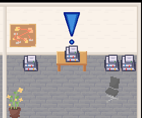

Produção autoral

#

Além disso, implementamos o primeiro personagem jogável do nosso jogo. As suas animações foram feitas com base em uma _spriesheet_, que representa diferentes _frames_ (quadros) da animação do personagem. Optamos por realizar sua inclusão na segunda _sprint_, como forma de tornar a cena da _hub_ mais completa, melhorando a experiência do usuário.

#

Figura 8: _Spritesheet_ do personagem:

Produção autoral

#

Por fim, também atualizamos a tela inicial do jogo, trazendo uma imagem de fundo animada. Ela também apresenta o logo do nosso jogo, trazendo uma maior identificação do jogador com o nosso _game_.

#

Figura 9: Menu Inicial:

Produção autoral

#

De forma geral, a _sprint_ 2 ficou marcada pelo desenvolvimento de novas habilidades, além de uma maior clarificação dos objetivos do nosso projeto. Ainda enfrentamos diversos desafios, principalmente em relação ao tempo de desenvolvimento, mas conseguimos cumprir as tarefas necessárias, tanto para o entregável quanto para apresentação ao parceiro.

Para os próximos passos, iremos implementar novas fases (dias) no nosso jogo, trazendo uma maior variedade de conteúdos. Também levaremos em conta o _feedback_ feito pelo parceiro.

## 4.3. Desenvolvimento intermediário do jogo (sprint 3)

No período de desenvolvimento da _sprint_ 3, focamos em correções apontadas pelo parceiro de projeto, além da implementação da segunda fase, com foco nos _minigames_ desse dia.

Entre os problemas levantados, é importante destacar dois deles: a _hub_ do jogo, que era grande demais. Pelo fato de conter diversas salas, e um ambiente considerável para explorar, o nosso jogo não levava em conta a acessibilidade. Algumas pessoas que não estão acostumadas em jogar _videogames_ poderiam acabar se frustrando. Além disso, o foco principal do projeto é o ensinamento dos conteúdos para o _onboarding_.

Como solução, optamos por criar uma versão reduzida da _hub_, porém mantendo os aspectos essenciais. Mantivemos a utilização do _software_ _Tiled_, utilizando de marcações presentes no chão para guiar o jogador ao caminho necessário para a progressão. De forma geral, a _hub_ ainda representa um andar de um escritório, mantendo objetos-chave, como computadores e papéis.

#

Figura 1: Novo _layout_ da _hub_:

Produção autoral

#

Outro problema apontado foi a implementação do _minigame_ 2. Ele se tratava da análise de transações suspeitas, permitindo com que o usuário avaliasse se os casos apresentados eram verídicos. No entanto, o conteúdo não se alinhava com aquilo que era desejado para o _onboarding_. Por esse motivo, alteramos a ideia por trás desse _minigame_.

O novo _minigame_ 2 aborda temas voltados para a matemática financeira, como o cálculo de juros, por exemplo. Ela apresenta o histórico de transações dos clientes, fornecendo as informações essenciais para que o jogador calcule o saldo final.

#

Figura 2: Novo _minigame 2:

Produção autoral

#

Por se tratar de um assunto mais complexo, o material de apoio desse _minigame_ também teve que ser expandido. Para evitar com que o usuário esqueça de pontos importantes, implementamos um botão de voltar atrás no material de apoio, permitindo com que ele leia seções anteriores. O objetivo é implementar esse botão no material de apoio de todos os _minigames_, no entanto, só houve tempo hábil para implementar essa função no _minigame_ 2, durante a segunda _sprint_.

#

Figura 3: Exemplo de parte do material de apoio do _minigame_ 2:

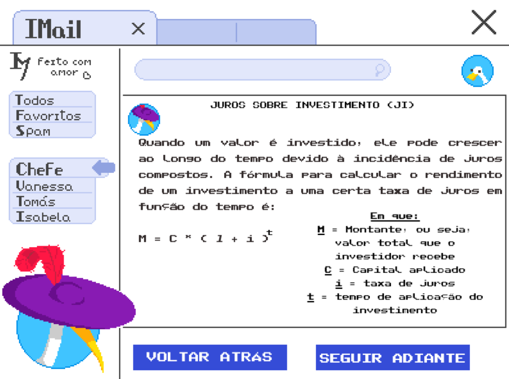

Produção autoral

#

Com todos os aspectos da _sprint_ 2 de acordo com os desejos do parceiro, voltamos o nosso foco para a implementação de novas partes do projeto. A primeira delas foi o _miniboss_ do dia 1. Ele é um quiz, contendo 3 perguntas, cada uma sobre o conteúdo presente em um _minigame_. As perguntas são selecionadas de um banco de questões, totalizando 9 opções. No entanto, para evitar com que todas as perguntas sejam de apenas um tópico, o código garante que apenas uma pergunta por conteúdo será selecionada.

#

Figura 4: Exemplo de questão do _miniboss_:

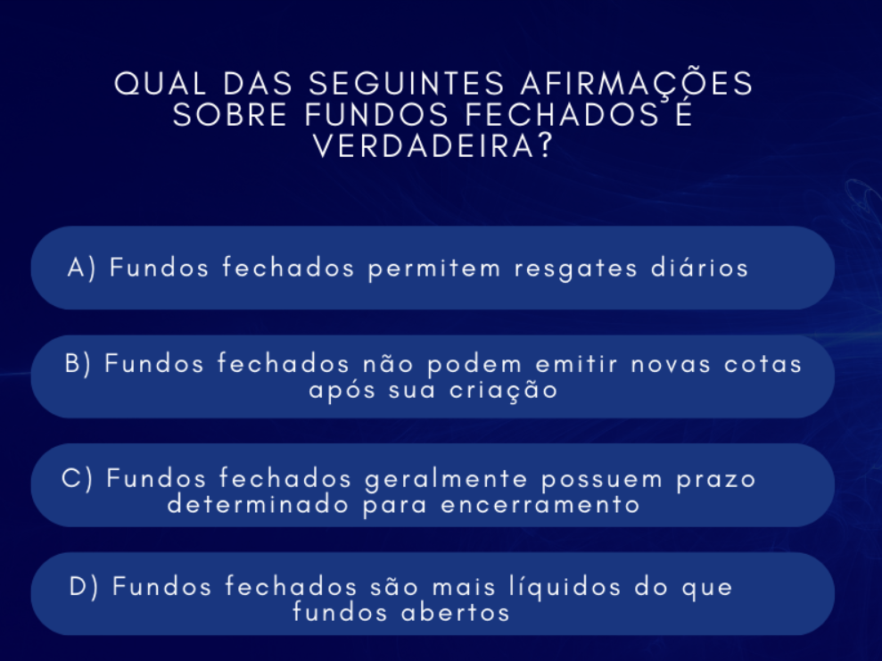

Produção autoral

#

Após o usuário escolher uma alternativa, ele será apresentado o _feedback_ de sua performance logo em seguida. Ou seja, caso ele tenha errado a questão, ele receberá uma explicação sobre a maneira correta de responder a pergunta.

#

Figura 5: Exemplo de _feedback_:

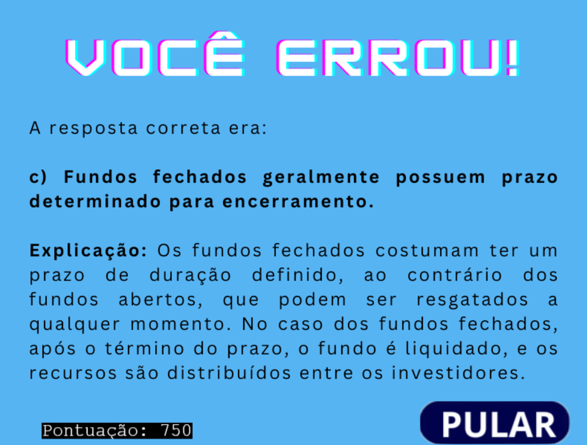

Produção autoral

#

Em seguida, optamos por desenvolver os _minigames_ do segundo dia. Focamos em adicionar novas mecânicas de jogo, para trazer uma experiência mais variada. O primeiro deles é sobre impostos existentes no mundo financeiro. O jogador é apresentado quatro impostos diferentes, cada um contendo uma questão para o usuário resolver. Após ele selecionar uma opção, ele é conduzido para uma lousa digital, servindo como rascunho para os seus cálculos.

#

Figura 6: _Gameplay_ do _minigame_ 4:

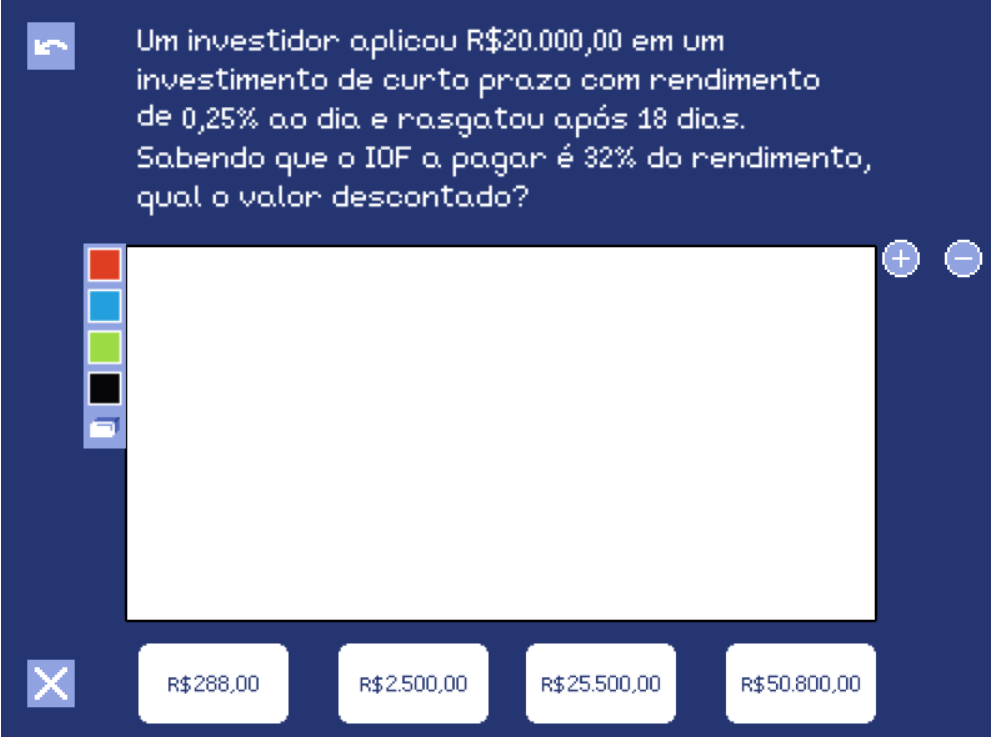

Produção autoral

#

O quinto _minigame_ aborda termos comuns do mercado financeiro. O jogador precisa ligar o nome dos conceitos com a sua definição correta. Essa ação é feita utilizando o botão esquerdo do mouse, arrastando uma linha para interligar as opções. Conforme dito anteriormente, todo os conteúdos estão presentes no material de apoio de cada _minigame_.

#

Figura 7: _Gameplay_ do _minigame_ 5:

Produção autoral

#

O último _minigame_ realizado nessa _sprint_ busca trazer um pouco da cultura empresarial do parceiro de projeto. Com base nos principais valores da empresa, o jogador deve analisar diversos perfis de candidatos, e selecionar aqueles que melhor se encaixam. Tal ação é feita por meio de dois botões presentes na tela, um para aprovar e outro para recusar.

#

Figura 8: _Gameplay_ do _minigame_ 6:

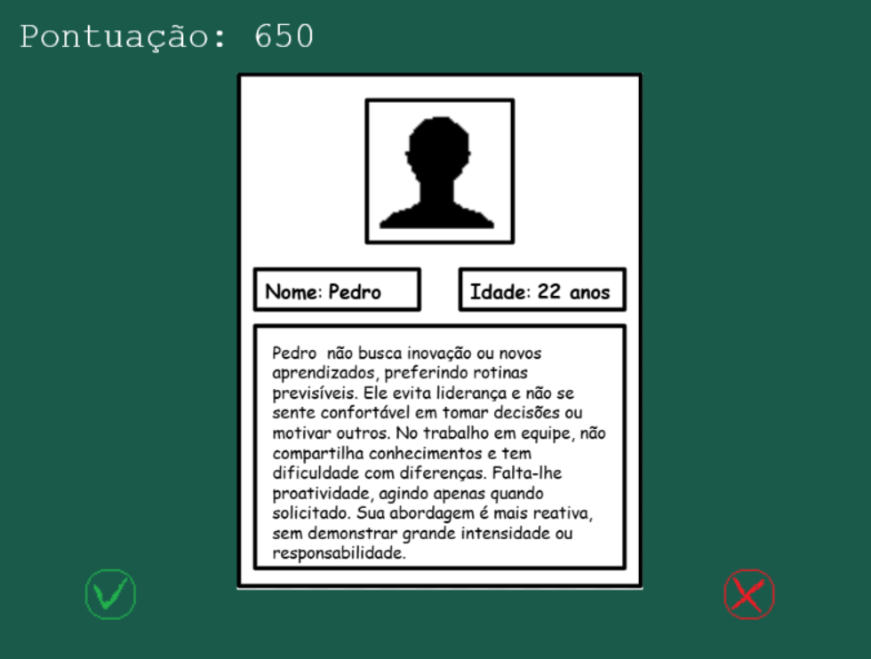

Produção autoral

#

Além disso, também introduzimos a opção do jogador selecionar o personagem jogável, entre quatro opções diferentes. Tomamos essa decisão com base em nossa aula de inclusão e diversidade. Por meio de decisões como essa, é possível aumentar o engajamento do jogador com a experiência. Sobre o código, é importante destacar que a seleção do jogador é guardada em uma variável. Isso ocorre pois os diferentes dias no jogo utilizam de outras cenas da _hub_. Logo, para manter a consistência, todas essas cenas conseguem identificar a escolha do jogador, e assim mostrar o personagem correto.

#

Figura 9: Tela de seleção de personagens:

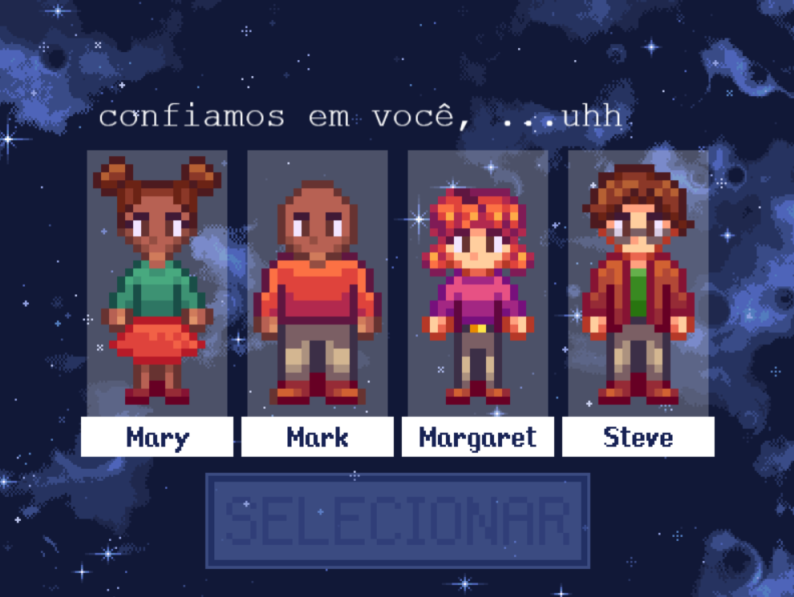

Produção autoral

#

Figura 10: Exemplo do código da seleção de personagens:

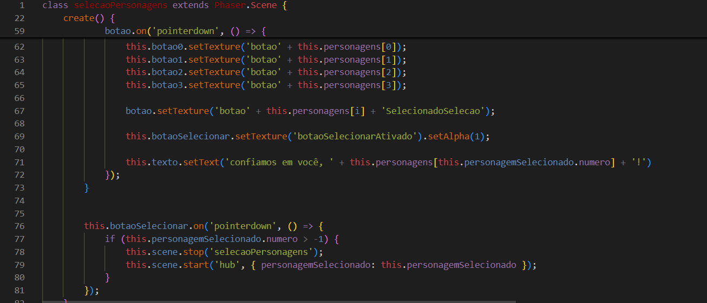

Produção autoral

#

Por fim, também adicionamos telas de _feedback_ após a realização do _miniboss_. Elas alteram-se de acordo com a sua performance do jogo. Elas possuem função estética quanto mecânica. Por um lado, ajudam a compor a atmosfera da experiência, sendo apresentada como uma edição de jornal. Porém, ela também serve como um alerta de performance para o jogador, indicando se está indo abaixo ou acima do esperado.

#

Figura 11: Exemplo da tela de _feedback_:

Produção autoral

#

Por se tratar de uma _sprint_ mais curta, por causa do feriado, o desenvolvimento acabou sendo mais corrido. Um fator notável foi a rotatividade dos papéis exercidos pelos integrantes, que permitiu com que todos pudessem trabalhar em diferentes áreas do projeto. Sob um olhar geral, o grupo conseguiu cumprir aquilo que tinha proposto. Para os próximos passos, continuaremos ajustando o nosso projeto com base nos _feedbacks_ recebidos, e começaremos o desenvolvimento da fase da Sala de Guerra.

## 4.4. Desenvolvimento final do MVP (sprint 4)

A construção de um MVP (Produto Mínimo Viável) é essencial para validar, de forma rápida e eficiente, uma proposta de valor antes da implementação completa. Com o uso mínimo de recursos, é possível testar a solução, obter feedback, identificar melhorias e entender melhor o cliente, reduzindo riscos e apoiando decisões mais assertivas com base em dados reais.
Por esse motivo, nossa prioridade nesta sprint foi finalizar e viabilizar o jogo em sua totalidade. Considerando que já abordamos conteúdos mais densos nas primeiras duas fases e, alinhando esse fator à limitação de tempo disponível, validamos com o parceiro, ao final da sprint 3, a não necessidade de uma terceira fase com novos conteúdos. Em vez disso, optamos por uma abordagem focada em uma nova fase apenas destinada à revisão e consolidação dos conteúdos já trabalhados.
Portanto, acreditamos que a revisão de conteúdos contribui significativamente para a eficiência do aprendizado, pois reforça conhecimentos previamente adquiridos, corrige possíveis lacunas e promove uma compreensão mais sólida. Esse processo facilita a fixação das informações e prepara melhor os participantes para a aplicação prática dos conceitos. (DUNLOSKY ET AL. 2013)
Com base nesse contexto, o MVP do jogo foi estruturado com duas fases principais, cada uma contendo três Miniboss, e um “Boss Level” como fase revisional, intitulada "Sala de Guerra". O jogo tem início em um mapa que simula o ambiente de um escritório bancário e, logo no início, o jogador é impactado por uma notícia de crise global, recebida por meio de um e-mail exibido na tela.

Tela inicial do jogo
Desing: Lucas Michel
O MVP da tela final contribui visuamente para a construção do contexto do jogo e oferece coerência ao jogo a partir de elementos relacionados ao mercado de fundos de investimentos.

Portanto, como consolidação inicial do MVP, nessa sprint aprimoramos o desing da tela de e-mail, garantindo maior imersão e clareza na narrativa. O objetivo da tela de e-mail é abordar e explicar o contexto do nosso jogo, com o objetivo de dinamizar a experiência e trazer instruções do jogo de tela de e-mail. Após essa etapa, o jogador compreenderá que estará inserido em um contexto de crise global, que serve como base para todo o design do nosso MVP. Por isso, realizamos os ajustes necessários no código do jogo e incorporamos todos os nossos sistemas de feedback. 

Tela de e-mail antiga
Tela de e-mail nova.

Ainda consolidando o MVP, optamos por manter o miniboss da fase um, considerando sua relevância dentro da narrativa e seu papel estratégico na progressão do jogo. Sua permanência contribui para a continuidade da experiência do jogador, além de reforçar elementos-chave já validados nas etapas anteriores do desenvolvimento.

FOTO

Durante a última sprint, concentramos nossos esforços na validação dos jogos da Fase Dois,  ajustando funcionalidades e refinando a experiência do usuário. Com base nesses resultados, conseguimos integrar e consolidar todos os aprimoramentos realizados ao longo do ciclo de desenvolvimento, chegando a versões finais mais estáveis e coerentes com a proposta do parceiro. 

Com base no miniboss desenvolvido para a Fase Um, criamos um novo miniboss para a Fase Dois, mantendo o mesmo contexto narrativo e temático. Essa continuidade fortalece a imersão do jogador e garante coerência entre as fases, ao mesmo tempo em que introduz novos desafios alinhados à progressão da história. 

Diferentemente do fluxo tradicional de trabalho, a sala de guerra concentra esforços de forma intensiva e coordenada. As decisões são tomadas em tempo real, com comunicação direta entre todos os envolvidos, sem a necessidade de passar por longas cadeias hierárquicas. Isso acelera a identificação de causas, a definição de soluções e a execução de ações. O ambiente da sala de guerra também promove um senso de urgência e colaboração constante, criando condições para que o grupo atue com máxima eficiência. Ademais, a sala de guerra tem um início e um fim bem definidos. Ela é montada com um propósito claro e, ao alcançar seu objetivo, seja corrigir uma falha, lançar um produto ou restabelecer um serviço, é desativada.
Por isso, ao abordar um contexto de crise no jogo, propomos a sala de guerra como conclusão e encerramento, a fim de que todos os conteúdos sejam abordados novamente, porém com um limite de tempo e com uma outra dinâmica, aproximando o jogador do contexto real da empresa e consolidando um processo de onboarding eficaz.

Conclui-se, portanto, que a progressão do jogador ao longo da experiência foi cuidadosamente estruturada, iniciando pela Fase Um, que introduz os elementos fundamentais do enredo e da mecânica, passando pela Fase Dois, que aprofunda os desafios e amplia a complexidade da narrativa, até alcançar a Fase de Guerra, etapa final e decisiva do jogo. Essa trajetória progressiva assegura uma evolução consistente na jogabilidade e no envolvimento do jogador, proporcionando uma experiência completa, desafiadora e alinhada aos objetivos centrais do projeto.

## 4.5. Revisão do MVP (sprint 5)

_Descreva e ilustre aqui o desenvolvimento dos refinamentos e revisões da versão final do jogo, explicando brevemente o que foi entregue em termos de MVP. Utilize prints de tela para ilustrar._

# 5. Testes

## 5.1. Casos de Teste (sprints 2 a 4)

Os seguintes casos de teste abordam o funcionamento dos _minigames_ e da _hub_ referentes ao dia 1 do jogo, além do funcionamento do menu inicial.

| número | pré-condição                                                                  | descrição do teste                                                                                             | pós-condição                                                                                                                                                      |
| ------ | ----------------------------------------------------------------------------- | -------------------------------------------------------------------------------------------------------------- | ----------------------------------------------------------------------------------------------------------------------------------------------------------------- |
| 1      | entrar no _link_ do jogo                                                      | apertar o botão: jogar                                                                                         | o jogo deve passar para uma cena explicando os controles básicos                                                                                                  |
| 2      | posicionar o personagem em em frente a um objeto que ainda não foi interagido | enquanto o personagem estiver colidindo com o objeto, apertar a barra de espaço                                | a explicação do _minigame_ deverá aparecer                                                                                                                        |
| 3      | iniciar o _minigame_ 1 (fundos de investimento)                               | arrastar o _card_ para uma das gavetas                                                                         | o _card_ deverá sair da tela, a pontuação aumentar/diminuir (dependendo da precisão da resposta) e um novo card deverá entrar na tela                             |
| 4      | iniciar o _minigame_ 2 (transações suspeitas)                                 | clicar no botão de verdadeiro ou falso                                                                         | o _card_ deverá sair da tela, a pontuação aumentar/diminuir (dependendo da precisão da resposta) e um dos _cards_ laterais deve ocupar a posição do _card_ antigo |
| 5      | iniciar o _minigame_ 3 (processo de resgate)                                  | clicar em um _card_ na parte superior da tela, e depois clicar em outro _card_ ao lado                         | o jogo deverá impedir a seleção de outro _card_, mantendo o original selecionado                                                                                  |
| 6      | iniciar o _minigame_ 3 (processo de resgate)                                  | clicar em um _card_ na parte superior da tela, e depois clicar em uma posição na linha do tempo                | o _card_ deverá se deslocar até a posição designada                                                                                                               |
| 7      | realizar o teste número 6                                                     | clicar em um _card_ que já está na linha do tempo, e depois clicar em outro local na linha do tempo            | o jogo deverá impedir que essa mudança ocorra, para evitar erros                                                                                                  |
| 8      | iniciar algum dos _minigames_                                                 | finalizar o _minigame_                                                                                         | o jogo deverá voltar até a _hub_, e o ponto de exclamação azul ao lado do terminal do _minigame_ escolhido deverá sumir                                           |
| 9      | posicionar o personagem em em frente a um objeto que já foi interagido        | enquanto o personagem estiver colidindo com o objeto, apertar a barra de espaço                                | o jogo deverá impedir que o _minigame_ ocorra novamente                                                                                                           |
| 10     | passar pelas duas primeiras cenas do jogo                                     | selecionar uma das opções de personagem jogáveis                                                               | o personagem selecionado deverá aparecer na próxima cena                                                                                                          |
| 11     | iniciar o _minigame_ 4 e escolher um dos _cards_                              | selecionar uma cor do lado esquerdo, e clicar e arrastar com o botão esquerdo na área branca da tela           | o rastro do mouse deverá aparecer na cor escolhida                                                                                                                |
| 12     | iniciar o _minigame_ 5                                                        | arrastar a linha de um _card_ vazio para outro _card_ que já foi conectado                                     | o jogo deverá impedir que os _cards_ se conectem                                                                                                                  |
| 13     | iniciar o _minigame_ 6                                                        | apertar o botão verde ou vermelho                                                                              | o jogo deverá atualizar a pontuação no canto superior da tela, conforme a precisão da resposta                                                                    |
| 14     | iniciar o material de apoio do _minigame_ 2                                   | clicar no botão de seguir adiante, e depois clicar no botão de voltar atrás, para todas as páginas do material | o jogo deverá transicionar as cenas conforme o esperado                                                                                                           |
| 15     | terminar os três _minigames_ do dia 1                                         | responder as questões do _miniboss_                                                                            | o jogo deverá apresentar uma de três telas de jornal de acordo com a sua performance                                                                              |

## 5.2. Testes de jogabilidade (playtests) (sprint 4)

### 5.2.1 Registros de testes

_Descreva nesta seção as sessões de teste/entrevista com diferentes jogadores. Registre cada teste conforme o template a seguir._

| Nome                                     | João Jonas (use nomes fictícios)                                                                                                         |
| ---------------------------------------- | ---------------------------------------------------------------------------------------------------------------------------------------- |
| Já possuía experiência prévia com games? | sim, é um jogador casual                                                                                                                 |
| Conseguiu iniciar o jogo?                | sim                                                                                                                                      |
| Entendeu as regras e mecânicas do jogo?  | entendeu as regras, mas sobre as mecânicas, apenas as essenciais, não explorou os comandos complexos                                     |
| Conseguiu progredir no jogo?             | sim, sem dificuldades                                                                                                                    |
| Apresentou dificuldades?                 | Não, conseguiu jogar com facilidade e afirmou ser fácil                                                                                  |
| Que nota deu ao jogo?                    | 9.0                                                                                                                                      |
| O que gostou no jogo?                    | Gostou de como o jogo vai ficando mais difícil ao longo do tempo sem deixar de ser divertido                                             |
| O que poderia melhorar no jogo?          | A responsividade do personagem aos controles, disse que havia um pouco de atraso desde o momento do comando até a resposta do personagem |

### 5.2.2 Melhorias

_Descreva nesta seção um plano de melhorias sobre o jogo, com base nos resultados dos testes de jogabilidade_

# 6. Conclusões e trabalhos futuros (sprint 5)

_Escreva de que formas a solução do jogo atingiu os objetivos descritos na seção 1 deste documento. Indique pontos fortes e pontos a melhorar de maneira geral._

_Relacione os pontos de melhorias evidenciados nos testes com plano de ações para serem implementadas no jogo. O grupo não precisa implementá-las, pode deixar registrado aqui o plano para futuros desenvolvimentos._

_Relacione também quaisquer ideias que o grupo tenha para melhorias futuras_

# 7. Referências (sprint 5)

OSTERWALDER, Alexander et al. Value proposition design: How to create products and services customers want. John Wiley & Sons, 2015.

MAGRETTA, Joan. Entendendo Michael Porter: o guia essencial da competição e estratégia. Rio de Janeiro: Alta Books, 2019. 1 recurso online. ISBN 9788550805047. Disponível em: https://integrada.minhabiblioteca.com.br/books/9788550805047. Acesso em: 23 fev. 2025. 

MOBA, RPG, MMORPG, FPS e mais: entenda significado dos gêneros de games. Disponível em: https://www.techtudo.com.br/noticias/2021/03/moba-rpg-mmorpg-fps-e-mais-entenda-significado-dos-generos-de-games.ghtml. Acesso em : 23 fev. 2025. 

NAKAGAWA, Marcelo. Ferramenta: 5 Forças de Porter. [S. l.: s. n.], [20--]. Disponível em: https://sebrae.com.br/Sebrae/Portal%20Sebrae/Anexos/ME_5-Forcas-Porter.PDF?ref=productoversee.com. Acesso em: 23 fev. 2025. 

BTG PACTUAL.Negócio e Histórico,2025.Disponível em: https://ri.btgpactual.com/sobre-o-banco/negocio-e-historico/#:~:text=O%20Banco%20BTG%20Pactual%20%C3%A9,internacional%20de%20investimentos%20e%20distribui%C3%A7%C3%A3o. Acesso em : 23 fev. 2025. 

SEBRAE.Público Alvo,2025.Disponível em : https://sebrae.com.br/sites/PortalSebrae/artigos/como-determinar-o-publico-alvo-da-sua-empresa,fa1c7553c86c6810VgnVCM1000001b00320aRCRD. Acesso em : 23 fev. 2025. 

POLTERGEISTERS. Slightly Cuter Character Sprites. Nexus Mods, 2017. Disponível em: https://www.nexusmods.com/stardewvalley/mods/1437. Acesso em: 27 fev. 2025.

ALIYACH. Portrait Accurate NPC Sprites. Nexus Mods, 2023. Disponível em: https://www.nexusmods.com/stardewvalley/mods/17289. Acesso em: 27 fev. 2025.

DEEP-FOLD. PixelSpace. GitHub, 2021. Disponível em: https://github.com/Deep-Fold/PixelSpace. Acesso em: 27 fev. 2025.

GLOBALDATA. Banco BTG Pactual S.A.: SWOT Analysis. Disponível em: https://www.globaldata.com/company-profile/banco-btg-pactual-sa/swot-analysis/. Acesso em: 28 fev. 2025.

DCF MODELING. BTG Pactual: Porter’s Five Forces Analysis. Disponível em: https://dcfmodeling.com/pt/products/btg-porters-five-forces-analysis. Acesso em: 28 fev. 2025.

ASANA. Análise SWOT: o que é, importância e como fazer. Disponível em: https://asana.com/pt/resources/swot-analysis. Acesso em: 28 fev. 2025.

BTG PACTUAL. Nosso DNA: Valores. Disponível em: https://www.btgpactual.com/nosso-dna/valores. Acesso em: 28 fev. 2025.

BRASIL. Instituto Brasileiro de Geografia e Estatística (IBGE). Censo Demográfico 2022: Resultados preliminares. Rio de Janeiro, 2022. Disponível em: https://www.ibge.gov.br. Acesso em: 24 mar. 2025.

HALLIDAY, David; RESNICK, Robert; WALKER, Jearl. Fundamentos de Física: Mecânica – Volume 1. 12. ed. Rio de Janeiro: LTC, 2023.

# Anexos

_Inclua aqui quaisquer complementos para seu projeto, como diagramas, imagens, tabelas etc. Organize em sub-tópicos utilizando headings menores (use ## ou ### para isso)_
