# GDD - Game Design Document - Módulo 1 - Inteli

## Nome do Grupo

#### Nomes dos integrantes do grupo

Ana Cristina Alves Jardim  
Henrique de Lima da Rós  
Lucas Garcia Rodrigues Lopes  
Lucas Michel Pereira  
Nicole Zanin Silva  
João Cardoso Dias  
Teodoro Borges de Carvalho Neira  

## Sumário

[1. Introdução](#c1)

[2. Visão Geral do Jogo](#c2)

[3. Game Design](#c3)

[4. Desenvolvimento do jogo](#c4)

[5. Casos de Teste](#c5)

[6. Conclusões e trabalhos futuros](#c6)

[7. Referências](#c7)

[Anexos](#c8)

 

# 1. Introdução (sprints 1 a 4)

## 1.1. Plano Estratégico do Projeto

### 1.1.1. Contexto da indústria (sprint 2)

Os fundos de investimento tiveram aportes líquidos de R$ 40,1 bilhões em abril de 2024, de acordo com a ANBIMA (Associação Brasileira das Entidades dos Mercados Financeiro e de Capitais). O valor representa a segunda maior captação líquida do ano, atrás apenas de janeiro, que fechou com R$ 52,1 bilhões. O acumulado de 2024 é positivo em R$ 150,8 bilhões. O BTG Pactual é um banco de investimentos que fornece uma grande gama de serviços, como mercado de capitais, prestação de serviço de consultoria financeira para empresas e etc. Fornecem serviços de corretagem, compensação e custódia de vários produtos no mercado latino-americano para uma base de clientes diversificada.

#### 1.1.1.1. Modelo de 5 Forças de Porter (sprint 2)

O BTG Pactual é considerado um dos líderes no cenário dos investimentos, operando em um mercado caracterizado por uma concorrência acirrada. Logo, para uma análise aprofundada do contexto desse setor, é preciso recorrer a uma ferramenta de análise estratégica reconhecida, como o modelo das 5 Forças de Porter. Conforme apresentado por Magretta (2019), para que uma empresa/organização avalie ou formule uma estratégia de mercado é preciso utilizar a estrutura das cinco forças, essa estrutura foi formulada por Michael Porter e fornece parâmetros para medir o desempenho superior e foca na competição a ser enfrentada. Além disso, essa ferramenta busca entender o que acontece em determinado setor, fornecendo uma visão clara e direta que está relacionada com a lucratividade do mercado. Para obter uma análise completa, as cinco forças de Porter se dividem em ameaça de entrada de novos concorrentes, ameaça de produtos substitutos, poder de negociação dos clientes, poder de negociação dos fornecedores e rivalidade entre os concorrentes (PORTER, 1896). Elas são:

**Ameaça de entrada de novos concorrentes:** consiste nas métricas de entrada no setor. Quanto mais difícil for a entrada, menor é a concorrência e maior a probabilidade de lucros a longo prazo. Segundo Porter (1896), as barreiras que dificultam a entrada de novos concorrentes são: economias de escala, diferenciação de produto, exigências de capital, custo de troca, acesso aos canais de distribuição, desvantagem de custos e políticas governamentais(NAKAGAWA, [20--]).

**Ameaça de Produtos Substitutos:** refere-se à facilidade com que o comprador pode substituir um tipo de produto ou serviço por outro(NAKAGAWA, [20--]).

**Poder de Barganha dos Compradores:** refere-se à influência dos clientes em relação ao preço de aquisição do produto. É considerado alto quando os clientes compram em grandes volumes, têm interesse em economias e estão preocupados com a qualidade do produto adquirido(NAKAGAWA, [20--]).

**Poder de Barganha dos Fornecedores:** é definido pelo poder de negociação em insumos de produção e disponibilidade de materiais. Os fornecedores são considerados poderosos quando não têm que lutar contra outros produtos substitutos, não dependem dos compradores e possuem produtos únicos e insubstituíveis para os compradores(NAKAGAWA, [20--]).

**Rivalidade entre os Concorrentes Existentes:** define o nível de competição em um setor. É mais intenso quando o número de empresas competindo é grande e quando as empresas sofrem restrições de tempo para venda do produto(NAKAGAWA, [20--]).

Utilizando os conceitos discutidos, é possível aplicar a estrutura das 5 Forças de Porter ao BTG Pactual para avaliar sua posição competitiva e identificar os principais impulsionadores de lucratividade e os desafios enfrentados pela empresa.

**Ameaça de produtos substitutos:** o nível de ameaça de produtos substitutos para o BTG Pactual varia conforme seus segmentos de atuação, mas é alto em algumas áreas estratégicas. No mercado de investimentos, fintechs e corretoras independentes oferecem alternativas acessíveis e automatizadas, desafiando os serviços tradicionais de wealth management e asset management. No corporate banking e mercado de crédito, bancos digitais e plataformas de financiamento descentralizado (DeFi) criam novas formas de captação de recursos, reduzindo a dependência de grandes instituições.

**Poder de negociação dos compradores:** o poder de negociação dos compradores do BTG Pactual pode ser considerado moderado, variando conforme o perfil do cliente. Grandes investidores, clientes institucionais e grandes fundos de investimento exercem uma influência significativa, pois movimentam altos volumes de capital e têm maior poder de barganha. Eles podem negociar taxas mais competitivas, acesso a produtos exclusivos, serviços personalizados e condições diferenciadas para otimizar seus investimentos.

**Rivalidade entre os concorrentes:** a rivalidade entre os concorrentes do BTG Pactual é alta, especialmente no setor de investimentos e serviços financeiros. O mercado é altamente competitivo, com a presença de grandes bancos tradicionais, corretoras independentes e fintechs inovadoras, todos disputando a preferência de investidores institucionais e clientes de varejo. Os bancos tradicionais, como Itaú, Bradesco e Santander, possuem grande capilaridade e uma base consolidada de clientes, o que os torna concorrentes diretos em diversas frentes. Já as corretoras independentes, como XP Investimentos e Genial, se destacam pela oferta de plataformas digitais ágeis e produtos financeiros personalizados, atraindo investidores que buscam maior autonomia e diversificação.

**Poder de negociação dos fornecedores:** o poder de barganha dos fornecedores do BTG Pactual varia de moderado a alto, especialmente em setores estratégicos como tecnologia, dados financeiros e consultoria especializada. Fornecedores de soluções tecnológicas, plataformas de análise de mercado e serviços de infraestrutura digital desempenham um papel essencial no suporte às operações do banco, tornando-se parceiros-chave na execução de suas atividades. A dependência de dados precisos e atualizados, bem como de sistemas robustos e seguros, confere a esses fornecedores uma influência significativa. No entanto, o BTG Pactual, por ser uma das maiores instituições financeiras da América Latina, possui um forte poder de negociação. Sua relevância no setor e seu volume de operações permitem que o banco exerça influência sobre os contratos, buscando sempre as melhores condições comerciais, alinhamento estratégico e inovação contínua. Além disso, a diversificação de fornecedores e investimentos em tecnologia própria ajudam a reduzir a dependência excessiva de qualquer parceiro específico, equilibrando essa dinâmica de poder.

**Ameaça de entrada de novos concorrentes:** a ameaça de entrada de novos concorrentes no mercado financeiro, especialmente no setor de investimentos, varia de moderada a alta. A indústria financeira é caracterizada por barreiras de entrada significativas, como a necessidade de grandes investimentos iniciais, conformidade regulatória rigorosa e a construção de uma infraestrutura robusta para atender a clientes de alta complexidade. No entanto, a transformação digital e o crescimento das fintechs têm diminuído algumas dessas barreiras, permitindo a entrada de novos players com modelos de negócios mais ágeis e custos mais baixos. As fintechs, em particular, têm se mostrado uma ameaça crescente, oferecendo soluções inovadoras, como plataformas de investimentos automatizados (robo-advisors), serviços bancários digitais e investimentos de impacto, que atraem, principalmente, os consumidores mais jovens e aqueles em busca de maior flexibilidade e custos reduzidos. Empresas de tecnologia também estão cada vez mais entrando no setor financeiro, trazendo expertise em dados, inteligência artificial e blockchain, o que pode representar uma disrupção no mercado.

Um exemplo prático da importância das Cinco Forças de Porter em relação ao BTG Pactual pode ser visto na crescente competição com fintechs e corretoras independentes, especialmente no segmento de investimentos. A ameaça de produtos substitutos tem se intensificado com o surgimento de plataformas digitais que oferecem produtos de investimento de forma simplificada, com baixas taxas e experiência 100% digital. Diante disso, a estratégia do BTG foi fortalecer sua presença digital por meio de iniciativas como a plataforma BTG Pactual digital, que oferece acesso a investimentos com taxas competitivas, interface intuitiva e serviços personalizados. Essa resposta estratégica mostra como a análise das Cinco Forças permitiu ao banco identificar riscos e oportunidades, adaptando-se às mudanças do mercado para manter sua posição competitiva.

Portanto,após a análise das Cinco Forças de Porter percebe-se que é uma ferramenta extremamente abrangente para avaliar o ambiente competitivo de uma indústria e ajudar as empresas a desenvolver estratégias eficazes para superar dilemas e aproveitar oportunidades. Ao entender tais forças, o BTG Pactual pode posicionar-se de forma mais competitiva e realista em seu mercado-alvo.

### 1.1.2. Análise SWOT (sprint 2)

A análise SWOT é uma ferramenta utilizada para identificar as forças, oportunidades, fraquezas e ameaças de uma empresa. Dessa forma, serve como uma forma de identificar oportunidades de melhoria frente à concorrência e à própria equipe, promovendo uma visão do atual cenário da empresa. No contexto da análise SWOT, há os fatores internos e externos. Entre os fatores internos, destacam-se as forças, que representam os aspectos positivos da empresa, como recursos, competências e ações estratégicas que proporcionam uma vantagem competitiva. Enquanto as fraquezas são o oposto, são as iniciativas internas que estão abaixo do esperado e indicam o que precisa ser feito para melhorar na empresa. Quanto aos fatores externos há as oportunidades e as ameaças. As oportunidades são as iniciativas externas às empresas, mas que promovem uma melhor posição competitiva. Em relação às ameaças, são os fatores externos que estão fora do controle da empresa e podem impactar negativamente o cenário competitivo. Desse modo, considerando as concepções da Análise SWOT foi possível identificar as forças, fraquezas, oportunidades e ameaças que contemplam o BTG Pactual, conforme consta abaixo.

**Forças:**

- **Liderança no mercado financeiro:** o BTG Pactual é o maior banco de investimentos da América Latina, com alta presença no setor financeiro.

- **Inovação e tecnologia:** forte investimento em soluções digitais e plataformas tecnológicas, como o BTG Pactual Digital, permitindo o crescimento no varejo financeiro.

- **Rede de clientes e relacionamento:** possui uma base sólida de clientes institucionais e de alta renda, além de um forte relacionamento com empresas e investidores.

- **Atuação em diversos segmentos:** mercado de capitais, crédito corporativo e gestão de fortunas, reduzindo riscos de dependência em um único setor.

**Fraquezas:**

- **Concorrência agressiva no digital:** no segmento de varejo digital, enfrenta concorrentes como Nubank, XP Investimentos e bancos tradicionais,que possuem forte base de clientes.

- **Exposição a riscos de mercado:** como banco de investimentos, está altamente exposto a oscilações macroeconômicas e crises financeiras.

- **Dependência de grandes clientes e investidores institucionais:** a maior parte das receitas vem de clientes de alta renda e grandes empresas, tornando-o vulnerável a mudanças de comportamento desse público.

**Ameaças:**

- **Concorrência forte:** disputa acirrada com bancos tradicionais e fintechs, que oferecem serviços mais acessíveis e taxas reduzidas.

- **Mudanças no perfil dos investidores:** novas gerações de investidores buscam alternativas mais simples e acessíveis, podendo migrar para concorrentes que ofereçam plataformas mais amigáveis.

- **Regulação rigorosa:** o setor financeiro está sujeito a regulações constantes, o que pode limitar algumas operações do banco.
- **Cibersegurança e Fraudes:** como banco digital e de investimentos, enfrenta riscos de ataques cibernéticos e vazamento de dados.

**Oportunidades:**

- **Crescimento no mercado de investimentos digitais:** com a popularização do investimento online, o BTG pode ampliar sua base de clientes via BTG Pactual Digital.

- **Cenário favorável para ativos alternativos:** o aumento do interesse por ativos como fundos estruturados, private equity e crédito privado pode impulsionar o banco.

- **Atuação internacional:** o BTG Pactual tem expandido sua atuação internacionalmente, podendo capturar mais oportunidades fora do Brasil.

- **Expansão para o varejo financeiro:** o banco tem ampliado sua atuação para o público de alta renda e varejo, competindo com fintechs e bancos tradicionais.

### 1.1.3. Missão / Visão / Valores (sprint 2)

Nosso projeto tem como missão transformar o onboarding de novos analistas de tecnologia do BTG Pactual com uma experiência gamificada, imersiva e alinhada aos desafios reais da empresa. Nossa visão é criar a principal ferramenta de integração para esses profissionais, tornando o aprendizado dinâmico e estratégico, refletindo o dinamismo do mercado financeiro. Guiamo-nos por valores essenciais, como excelência e inovação, para garantir uma experiência envolvente e eficiente; autonomia e protagonismo, incentivando o aprendizado ativo e contínuo, para além do onboarding; impacto e responsabilidade, demonstrando como cada decisão afeta os resultados do banco; e colaboração e engajamento, promovendo a integração.

### 1.1.4. Proposta de Valor (sprint 4)

_Posicione aqui o canvas de proposta de valor. Descreva os aspectos essenciais para a criação de valor da ideia do produto com o objetivo de ajudar a entender melhor a realidade do cliente e entregar uma solução que está alinhado com o que ele espera._

### 1.1.5. Descrição da Solução Desenvolvida (sprint 4)

_Descreva brevemente a solução desenvolvida para o parceiro de negócios. Descreva os aspectos essenciais para a criação de valor da ideia do produto com o objetivo de ajudar a entender melhor a realidade do cliente e entregar uma solução que está alinhado com o que ele espera. Observe a seção 2 e verifique que ali é possível trazer mais detalhes, portanto seja objetivo aqui. Atualize esta descrição até a entrega final, conforme desenvolvimento._

### 1.1.6. Matriz de Riscos (sprint 4)

_Registre na matriz os riscos identificados no projeto, visando avaliar situações que possam representar ameaças e oportunidades, bem como os impactos relevantes sobre o projeto. Apresente os riscos, ressaltando, para cada um, impactos e probabilidades com plano de ação e respostas._

### 1.1.7. Objetivos, Metas e Indicadores (sprint 4)

_Definição de metas SMART (específicas, mensuráveis, alcançáveis, relevantes e temporais) para seu projeto, com indicadores claros para mensuração_

## 1.2. Requisitos do Projeto (sprints 1 e 2)

Durante a reunião com o parceiro do projeto foi possível definir uma série de requisitos que contemplam desde a estética até a mecânica do jogo.

Quadro 02 - Requisitos do Projeto

**Quadro de requisitos**
\# | **Requisito**  
--- | ---
1 |O jogo será desenvolvido para Web, acessível através de um PC.
2 |O jogo terá uma câmera oblíqua que seguirá o jogador, garantindo visão ampla do ambiente.
3 |O jogador se movimentará pelo mapa utilizando as setas do teclado.
4 |O jogador poderá interagir com botões e menus na tela utilizando o botão esquerdo do mouse.
5 |A interação com terminais, computadores e outros elementos do cenário será realizada pressionando a tecla "espaço".
6 |As tasks estarão espalhadas por todo o escritório virtual, incentivando a exploração.
7 |O jogador poderá escolher a ordem em que deseja realizar as tasks.
8 |Se o jogador errar uma task, não poderá refazê-la, impactando o desempenho da empresa.
9 |Algumas interações abrirão menus de tarefas ou quizzes na tela, exigindo tomada de decisão ou conhecimento técnico.
10|O progresso do jogador será avaliado em tempo real com base no seu desempenho nas tasks.
11|No fim de cada fase, um jornal exibirá os impactos positivos ou negativos das decisões do jogador no banco.
12|O jogo terá níveis crescentes de dificuldade, exigindo mais atenção e estratégia a cada fase.
13|O jogador receberá moedas virtuais ao completar tarefas corretamente.
14|Conquistas serão desbloqueadas ao atingir certos marcos de progresso.
15|O jogador poderá gastar moedas para personalizar o seu personagem, adquirindo acessórios e itens cosméticos.

## 1.3. Público-alvo do Projeto (sprint 2)

O público-alvo consiste em um grupo de indivíduos com características em comum, tornando-os mais inclinados a consumir determinados produtos ou serviços oferecidos por uma empresa que os tem como foco (SEBRAE, [20--]).

Definir um público-alvo de forma estratégica garante uma vantagem competitiva, permitindo uma comunicação e um marketing mais eficazes, além de impulsionar as vendas. No entanto, uma definição muito ampla ou imprecisa pode gerar inconsistências, reforçando a importância de considerar aspectos como gênero, idade, localização, profissão e escolaridade ao traçar esse perfil (SEBRAE, [20--]).

Para alinhar o projeto de forma assertiva, foi estabelecido um público-alvo específico. O jogo Capital Downfall é voltado para pessoas de qualquer gênero, raça e etnia, com idade acima de 18 anos, que trabalham como analistas de fundos de investimentos no banco BTG. São indivíduos que buscam compreender melhor os processos internos da empresa, mas que podem enfrentar dificuldades devido à sua complexidade.

Além disso, o jogo se destina a profissionais responsáveis, comprometidos com a diversidade e representatividade no ambiente corporativo, bem como engajados na busca por conchecimento.

Outro fator importante relacionado ao público-alvo é o conceito de **personas**, que representam perfis detalhados e humanizados do público ideal. Essas personas levam em conta não apenas informações objetivas, mas também aspectos subjetivos, como medos, desafios, motivações e aspirações que impulsionam o interesse por um produto ou serviço (SEBRAE, [20--]).

Para garantir um jogo mais personalizado e voltado para experiências reais, foi definida uma persona que orientará o desenvolvimento da experiência oferecida.

### Persona do usuário:

- **Nome:** _Tiago Mendes_
- **Idade:** _24_
- **Gênero:** _Masculino_
- **Cargo:** _Analista de Fundos de Investimentos do BTG Pactual_

#### Características:

- Proativo
- Curioso
- Esforçado

#### Biografia:

Tiago Mendes é um analista de fundos de investimento recém-contratado para o BTG Pactual, nascido e criado em São Paulo. Possui graduação em Economia pela Universidade de São Paulo (USP) e pós-graduação em Gestão Financeira pela Fundação Getúlio Vargas (FGV). Destacou-se no gerenciamento de investimentos em diversos e-commerces antes de ser contratado pelo banco BTG, onde atualmente está realizando o processo de onboarding da empresa.

#### Dores:

- Falta de uma abordagem didática e prática para compreender os processos internos sobre fundos de investimento do banco BTG.
- Dificuldade em manter o foco e o engajamento ao longo de treinamentos tradicionais sobre conteúdos extensos e pouco didáticos.

#### Necessidades:

- Mecanismo que simplifique e promova o entendimento didático do processo de onboarding de fundos de investimentos do banco BTG.
- Treinamento mais divertido para manter sua atenção.

# 2. Visão Geral do Jogo (sprint 2)

## 2.1. Objetivos do Jogo (sprint 2)

Para concluir o jogo, o jogador deve avançar por quatro dias, cada um representando desafios progressivos dentro do ambiente corporativo do banco. No primeiro dia, ele inicia na hub principal do escritório e pode escolher a ordem das tarefas introdutórias, que abordam conceitos básicos e operações fundamentais do banco. Ao concluir todas as tarefas, um relatório em formato de jornal apresenta o impacto de suas decisões, determinando se pode prosseguir para o dia seguinte.

No segundo dia, as tarefas se tornam mais complexas, exigindo maior atenção aos detalhes e tomada de decisão estratégica. O jogador precisa lidar com desafios mais técnicos e gerenciar riscos operacionais. Ao final, novamente, o jornal avalia seu desempenho, e, caso tenha obtido um resultado satisfatório, ele avança para o próximo dia.

No terceiro dia, a crise financeira se intensifica e as tarefas ganham um nível de urgência maior. O jogador precisa gerenciar múltiplos problemas simultaneamente, tomando decisões que podem impactar diretamente o desempenho do banco. O relatório do jornal pode indicar estabilidade, recuperação parcial ou um cenário crítico, influenciando o desfecho da jornada.

No quarto e último dia, o jogador é levado a um ambiente de alta tensão, simulando uma verdadeira "sala de guerra", onde precisa tomar decisões rápidas e coordenar soluções para estabilizar o banco. As tarefas são ainda mais desafiadoras e exigem precisão para evitar o colapso financeiro. No final, o jornal apresenta o desfecho do jogo, que pode variar entre a recuperação total do banco, uma situação instável ou a falência definitiva.

## 2.2. Características do Jogo (sprint 2)

### 2.2.1. Gênero do Jogo (sprint 2)

Capital Downfall é um Role Playing Game(RPG) corporativo com elementos de simulação e estratégia. O jogador assume o papel de um analista de tecnologia de um banco e deve cumprir tarefas essenciais para manter o banco funcionando. A progressão ocorre por meio de decisões estratégicas, quizzes, resolução de desafios e mini-games, impactando diretamente o desempenho da empresa. Com um ambiente dinâmico e desafios progressivos, o jogo combina narrativa imersiva e aprendizado interativo, trazendo uma experiência única de gestão e tomada de decisões no mercado financeiro.

### 2.2.2. Plataforma do Jogo (sprint 2)

O jogo está sendo desenvolvido com a premissa de ser executado principalmente em computadores, sendo otimizado para essa plataforma. No entanto, ele também poderá ser acessado por meio de um link, o que possibilita que o jogo seja jogado em qualquer dispositivo com acesso à internet, como smartphones e tablets. Contudo, é importante ressaltar que a experiência foi projetada e ajustada com foco na interface e nas funcionalidades específicas para computadores. Portanto, embora o jogo seja acessível em diversas plataformas, a jogabilidade e a interação foram concebidas para proporcionar o melhor desempenho e usabilidade quando jogado em um computador.

### 2.2.3. Número de jogadores (sprint 2)

O jogo será projetado para ser jogado exclusivamente por um único jogador por vez, sem a implementação de modalidades multiplayer ou cooperativas. Cada sessão de jogo será uma experiência individual, focada no progresso e na conclusão das tarefas atribuídas ao jogador. Dessa forma, a dinâmica de jogo será centrada na imersão de um único participante, com a barra de tarefas servindo como indicador do avanço e da conclusão das fases. A ausência de modo multiplayer visa proporcionar uma experiência mais introspectiva e desafiadora, em que o jogador assume o papel exclusivo de progredir e conquistar vitórias ao completar suas tarefas, dentro de um ambiente visualmente envolvente e estruturado com a estética de pixel art.

### 2.2.4. Títulos semelhantes e inspirações (sprint 2)

Foram selecionados dois jogos como referência. O primeiro é Among Us, do qual será incorporada a mecânica de progressão de tarefas. No Among Us, quando um jogador completa uma "task", a barra de tarefas aumenta. Quando essa barra atinge o máximo, a fase é concluída, resultando na vitória do jogador. A segunda referência é Stardew Valley, porém, não pela mecânica do jogo, mas pela estética em pixel art, que será adotada no design visual. A combinação dessas influências visa criar uma dinâmica onde, por um lado, o progresso das tarefas traz uma sensação de colaboração, enquanto, por outro, a estética em pixel art oferece um ambiente visualmente acolhedor e nostálgico, contribuindo para uma experiência única e imersiva para os jogadores.

### 2.2.5. Tempo estimado de jogo (sprint 5)

O jogo pode ser concluído entre 15 e 20 minutos passando por todas as fases.

# 3. Game Design (sprints 2 e 3)

## 3.1. Enredo do Jogo (sprints 2 e 3)

_Descreva o enredo/história do jogo, criando contexto para os personagens (seção 3.2) e o mundo do jogo (seção 3.3). Uma boa história costuma ter um arco narrativo de contexto, conflito e resolução. Utilize etapas sequenciais para descrever esta história._

_Caso seu jogo não possua enredo/história (ex. jogo Tetris), mencione os motivos de não existir e como o jogador pode se contextualizar com o ambiente do jogo._

## 3.2. Personagens (sprints 2 e 3)

### 3.2.1. Controláveis

Todos os personagens do jogo deveriam ser inclusivos para cumprir o objetivo de tornar o jogador mais imerso, pois ele pode se identificar mais com a opção de personagem escolhida.

---

  Personagem 1: Mark 
   
  

---

  Personagem 2: Margaret 
  

---

  Personagem 3: Steve 
  

---

  Personagem 4: Mary 
  

### 3.2.2. Non-Playable Characters (NPC)

_\<opcional\> Se existirem coadjuvantes ou vilões, aqui é o local para descrevê-los e ilustrá-los. Utilize listas ou tabelas para organizar esta seção. Caso utilize material de terceiros em licença Creative Commons, não deixe de citar os autores/fontes. Caso não existam NPCs, remova esta seção._

### 3.2.3. Diversidade e Representatividade dos Personagens

O primeiro personagem do nosso jogo é o Mark, um analista júnior de 25 anos com experiência prévia em estágios no setor financeiro. Acreditamos que o Mark está totalmente alinhado com o nosso público-alvo, que são os analistas. Além disso, ele representa bem a realidade da sociedade brasileira, já que é um homem negro, jovem e no início de sua carreira. As escolhas feitas para a construção do Mark foram muito bem pensadas e terão um impacto positivo na questão da representatividade.

O segundo personagem é a Margaret, que tem uma carreira consolidada em contabilidade e planejamento financeiro, mas há quatro anos decidiu migrar para a área de fundos de investimento, onde se estabeleceu como uma analista experiente. A Margaret, apesar de sua trajetória inicial em outro setor, se encaixa perfeitamente no nosso público-alvo, já que possui quatro anos de experiência como analista. Em termos de representação da realidade brasileira, a Margaret traz a perspectiva de uma mulher experiente em sua área, mas que busca uma transição de carreira, mantendo-se dentro do nosso foco principal.

O terceiro personagem é o Steve, um jovem que sempre teve uma mente inquieta e apaixonada por números. Cresceu em um bairro simples, onde poucos falavam sobre tecnologia e investimentos, mas ele via neles um caminho para transformar sua vida. Aprendeu programação sozinho e logo percebeu o impacto que a tecnologia poderia ter no mercado financeiro. Mergulhou nos estudos, especializou-se em fundos de investimento e desenvolveu soluções inovadoras para análise de dados.

O quarto personagem é a Mary, uma cientista de dados com experiência em machine learning e inteligência artificial, que recentemente decidiu migrar para o setor financeiro. A Mary também está alinhada com o impacto que esperamos gerar, pois, ao contrário do Mark, ela não tem uma trajetória prévia no setor financeiro. A Mary, diferente do Mark, já tem uma carreira consolidada, mas isso não diminui sua representatividade. Pelo contrário, como uma mulher negra em uma posição de destaque, ela reforça a importância da representatividade e deve gerar um impacto significativo nesse aspecto.

Esses quatro personagens, com suas diferentes trajetórias e perfis, refletem a diversidade e a complexidade da sociedade brasileira, ao mesmo tempo em que se alinham com o público-alvo do nosso jogo. Essa abordagem trará um impacto positivo tanto em termos de engajamento quanto de representatividade.

## 3.3. Mundo do jogo (sprints 2 e 3)

### 3.3.1. Locações Principais e/ou Mapas (sprints 2 e 3)

_Descreva o ambiente do jogo, em que locais ele ocorre. Ilustre com imagens. Se houverem mapas, posicione-os aqui, descrevendo as áreas em acordo com o enredo. Se houverem fases, descreva-as também em acordo com o enredo (pode ser um jogo de uma fase só). Utilize listas ou tabelas para organizar esta seção. Caso utilize material de terceiros em licença Creative Commons, não deixe de citar os autores/fontes._

### 3.3.2. Navegação pelo mundo (sprints 2 e 3)

_Descreva como os personagens se movem no mundo criado e as relações entre as locações – como as áreas/fases são acessadas ou desbloqueadas, o que é necessário para serem acessadas etc. Utilize listas ou tabelas para organizar esta seção._

### 3.3.3. Condições climáticas e temporais (sprints 2 e 3)

_\<opcional\> Descreva diferentes condições de clima que podem afetar o mundo e as fases, se aplicável_

_Caso seja relevante, descreva como o tempo passa, se ele é um fator limitante ao jogo (ex. contagem de tempo para terminar uma fase)_

### 3.3.4. Concept Art (sprint 2)

    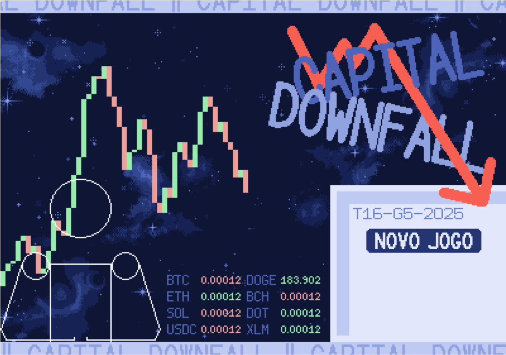 
    
Figura 1: tela inicial do jogo, apresentando a opção para o jogador iniciar uma nova partida.

    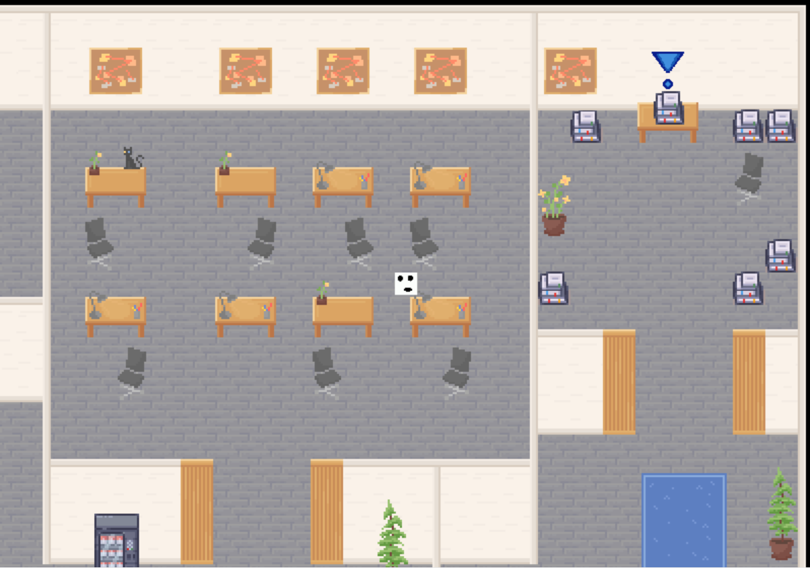 
    
Figura 2: visão do mapa inicial do jogo, destacando o ambiente do escritório. No canto superior direito, um computador com um ícone de exclamação indica que o jogador pode interagir com ele.

     
    
Figura 3: exemplo de material de apoio disponibilizado para o jogador antes de cada fase.

     
    
Figura 4: minijogo sobre diferenciação de fundos de investimento.

    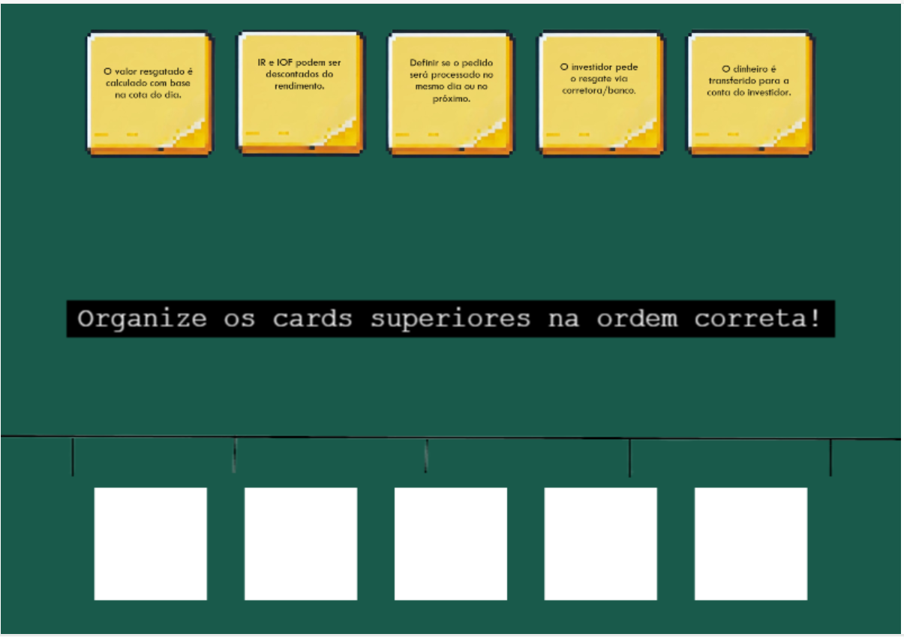 
    
Figura 5: minijogo sobre resgate em fundos de investimentoo.

     
    
Figura 6: minijogo sobre monitoramento de transações bancárias.

    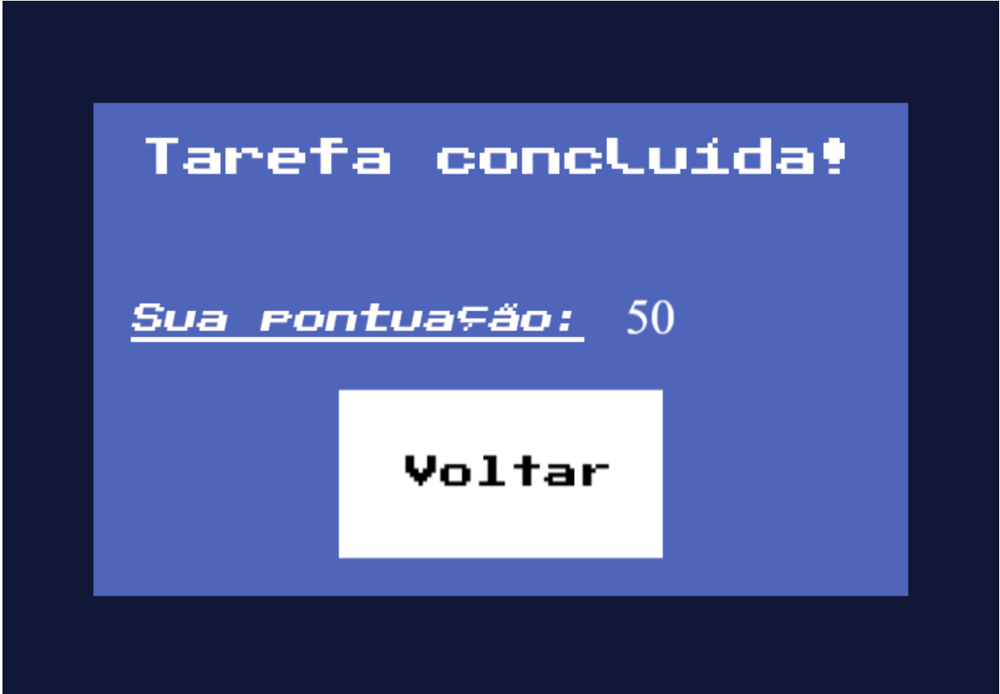 
    
Figura 7: tela exibida ao final de um minijogo, apresentando a pontuação final do jogador.

     
    
Figura 8: Concept art dos personagens Steve e Mary.

### 3.3.5. Trilha sonora (sprint 3)

_Descreva a trilha sonora do jogo, indicando quais músicas serão utilizadas no mundo e nas fases. Utilize listas ou tabelas para organizar esta seção. Caso utilize material de terceiros em licença Creative Commons, não deixe de citar os autores/fontes._

_Exemplo de tabela_
\# | titulo | ocorrência | autoria
--- | --- | --- | ---
1 | tema de abertura | tela de início | própria
2 | tema de combate | cena de combate com inimigos comuns | Hans Zimmer
3 | ...

## 3.4. Inventário e Bestiário (sprint 3)

### 3.4.1. Inventário

_\<opcional\> Caso seu jogo utilize itens ou poderes para os personagens obterem, descreva-os aqui, indicando títulos, imagens, meios de obtenção e funções no jogo. Utilize listas ou tabelas para organizar esta seção. Caso utilize material de terceiros em licença Creative Commons, não deixe de citar os autores/fontes._

_Exemplo de tabela_
\# | item | | como obter | função | efeito sonoro
--- | --- | --- | --- | --- | ---
1 | moeda |  | há muitas espalhadas em todas as fases | acumula dinheiro para comprar outros itens | som de moeda
2 | madeira |  | há muitas espalhadas em todas as fases | acumula madeira para construir casas | som de madeiras
3 | ...

### 3.4.2. Bestiário

_\<opcional\> Caso seu jogo tenha inimigos, descreva-os aqui, indicando nomes, imagens, momentos de aparição, funções e impactos no jogo. Utilize listas ou tabelas para organizar esta seção. Caso utilize material de terceiros em licença Creative Commons, não deixe de citar os autores/fontes._

_Exemplo de tabela_
\# | inimigo | | ocorrências | função | impacto | efeito sonoro
--- | --- | --- | --- | --- | --- | ---
1 | robô terrestre | 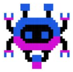 | a partir da fase 1 | ataca o personagem vindo pelo chão em sua direção, com velocidade constante, atirando parafusos | se encostar no inimigo ou no parafuso arremessado, o personagem perde 1 ponto de vida | sons de tiros e engrenagens girando
2 | robô voador |  | a partir da fase 2 | ataca o personagem vindo pelo ar, fazendo movimento em 'V' quando se aproxima | se encostar, o personagem perde 3 pontos de vida | som de hélice
3 | ...

## 3.5. Gameflow (Diagrama de cenas) (sprint 2)

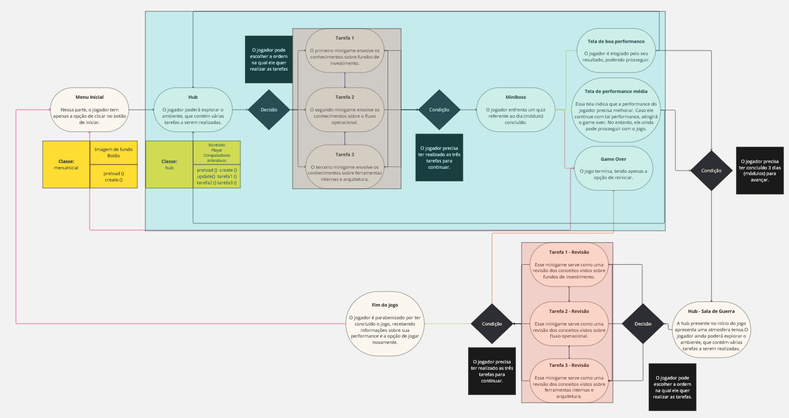

A trajetória do usuário em nosso jogo pode ser representada por meio do diagrama acima. Nele, o jogador inicia no Menu Inicial, podendo apertar o botão para começar. Após isso, ele será redirecionado para uma tela explicando o contexto por trás da narrativa. Depois, ele é posicionado na _hub_, durante o primeiro dia (módulo 1). Nesse módulo, ele vai poder selecionar a ordem das tarefas que ele irá realizar (totalizando três). Após essas atividades, ele enfrentará um _miniboss_, sendo ele um _quiz_ contendo perguntas sobre os assuntos abordados. Após esse acontecimento, ele é direcionado para uma de três possíveis telas. A primeira indica que ele teve um desempenho satisfatório, e que pode prosseguir. A segunda indica que ele teve um desempenho mediano, precisando melhorar no futuro. Nessa tela, ele ainda pode continuar. A terceira é a de _Game Over_, que ocorre quando ele não atinge a pontuação necessária durante as tarefas.

Em seguida, o jogador repete esse _loop_ de gameplay mais duas vezes, totalizando três dias. No final do terceiro dia, o jogador é direcionado para uma _hub_ alternativa. Ela possui uma atmosfera tensa, representando uma "sala de guerra". Nessa _hub_, o jogador segue o _loop_ existente na _hub_ normal, podendo escolher a ordem das três tarefas a serem realizadas. Quando as tarefas são terminadas, o jogador ou chegará na tela de _Game Over_, ou em uma tela parabenizando-o por ter finalizado a experiência.

A seção em rosa se refere representa a opção de escolha quanto a ordem de jogar os _minigames_, já a seção em azul representa o _loop_ de um dia.

## 3.6. Regras do jogo (sprint 3)

_Descreva aqui as regras do seu jogo: objetivos/desafios, meios para se conseguir alcançar_

_Ex. O jogador deve pilotar o carro e conseguir terminar a corrida dentro de um minuto sem bater em nenhum obstáculo._

_Ex. O jogador deve concluir a fase dentro do tempo, para obter uma estrela. Se além disso ele coletar todas as moedas, ganha mais uma estrela. E se além disso ele coletar os três medalhões espalhados, ganha mais uma estrela, totalizando três. Ao final do jogo, obtendo três estrelas em todas as fases, desbloqueia o mundo secreto._

## 3.7. Mecânicas do jogo (sprint 3)

_Descreva aqui as formas de controle e interação que o jogador tem sobre o jogo: quais os comandos disponíveis, quais combinações de comandos, e quais as ações consequentes desses comandos. Utilize listas ou tabelas para organizar esta seção._

_Ex. Em um jogo de plataforma 2D para desktop, o jogador pode usar as teclas WASD para mecânicas de andar, mirar para cima, agachar, e as teclas JKL para atacar, correr, arremesar etc._

_Ex. Em um jogo de puzzle para celular, o jogador pode tocar e arrastar sobre uma peça para movê-la sobre o tabuleiro, ou fazer um toque simples para rotacioná-la_

## 3.8. Implementação Matemática de Animação/Movimento (sprint 3)

_Descreva aqui a função que implementa a movimentação/animação de personagens ou elementos gráficos no seu jogo. Sua função deve se basear em alguma formulação matemática (e.g. fórmula de aceleração). A explicação do funcionamento desta função deve conter notação matemática formal de fórmulas/equações. Se necessário, crie subseções para sua descrição._

# 4. Desenvolvimento do Jogo

## 4.1. Desenvolvimento preliminar do jogo (sprint 1)

Para o desenvolvimento do nosso projeto, o método _Scrum_ foi utilizado. Nele, o desenvolvimento é divido em _sprints_, cada uma com 2 semanas de duração. Cada _sprint_ é essencial para o progresso do projeto, o primeiro deles sendo o mais significante, já que é o período na qual grupo estipulou o escopo do projeto, além de escolher a direção a ser seguida. Nessa etapa também foi definido que a linguagem de programação utilizada seria o JavaScript, unido ao framework Phaser.

De acordo com as mêcanicas definidas pela equipe, a tela escolhida para ser a primeira a ser desenvolvida foi a da interface do computador. Nela, o jogador recebe o contexto por trás da narrativa apresentada, além de ser o local que precede os minijogos. Ela precisava capturar a essência do projeto, sendo capaz de comunicar para o usuário o estilo de ensino abordado. Na parte do código, uma função de tempo foi utilizada, como forma de evitar que o jogador apenas pule a cena sem ao menos a ter lido. Além disso, um botão foi posicionado no canto inferior direito da tela que, ao ser clickado, mudaria para a cena seguinte.

A criação dessa tela não tem apenas uma importância técnica, mas também temática. Ela é essencial para a validação do progresso do projeto, permitindo que o grupo consiga entender se está seguindo o caminho correto de desenvolvimento, conforme o desejo da empresa parceira. No método _Scrum_, a constante incrementação dos entregáveis é uma de suas características marcantes, e essa cena também seguirá esses passos, sendo melhorada conforme o _feedback_ recebido.

Cena da interface do computador:

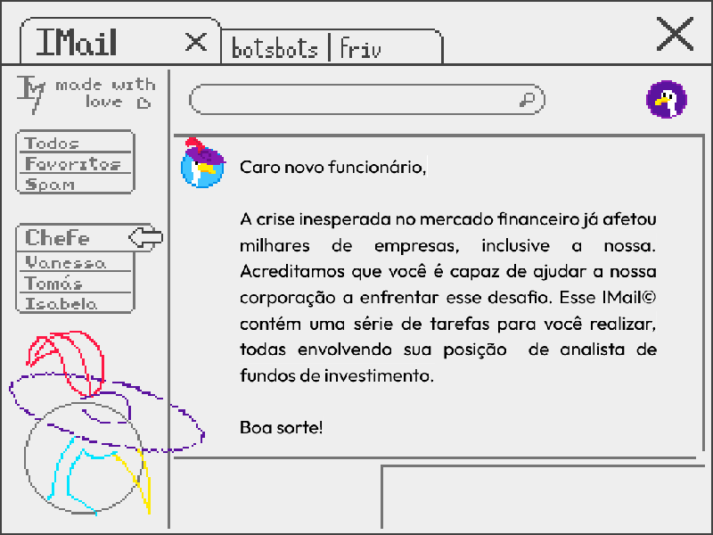

Parte do código referente a cena:

A outra cena escolhida para ser desenvolvida pelo grupo foi a da hub inicial. Isso se deve ao fato da mesma permitir o teste de algumas das tecnologias que serão utilizadas futuramente no projeto, com destaque para os _Tilesets_ e _Tilemaps_. Um _Tileset_ é um conjunto de imagens do mesmo tamanho, denominadas de _Tiles_, que servem como "blocos de construção" para cenas, permitindo que elas sejam criadas de maneira rápida e eficiente. Um _Tilemap_ é um arquivo que armazena as informações do posicionamento das _Tiles_ em uma cena, trazendo informações como colisões e camadas.

Além disso, a movimentação simples de um personagem foi implementada, se utilizando das "setinhas" para poder se deslocar pelo mapa. Interações simples com objetos também foi adicionada, permitindo que o jogador utilize da tecla "espaço" para realizar uma ação em determinado objeto.

Exemplo do _Tileset_ utilizado:

Parte do código referente a cena:

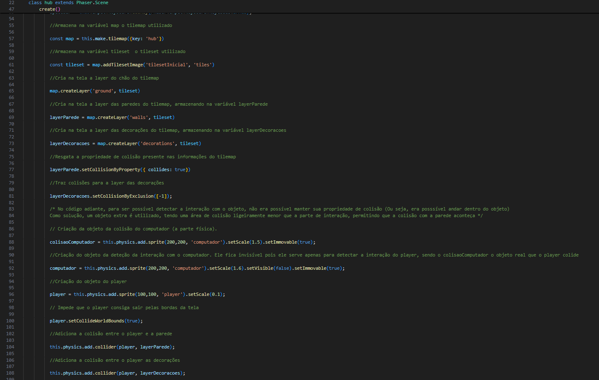

De forma geral, a _sprint_ 1 trouxe diversos desafios, porém também trouxe uma maior familiarização com o projeto e com as ferramentas a serem utilizadas. Um obstáculo significativo no decorrer do desenvolvimento foi a utilização do _Tilemap_, que envolve a referência de múltiplos outros arquivos e variáveis. A ideia central do projeto também foi alterada algumas vezes, para melhor condizer com os desejos da empresa parceira.

Para os próximos passos, pretendemos começar a implementação do conteúdo técnico requisitado pelo parceiro, além de iniciar a criação dos minijogos em si.

## 4.2. Desenvolvimento básico do jogo (sprint 2)

Para a _sprint_ 2, avançamos no desenvolvimento das cenas do jogo. Focamos nas cenas que compõe o primeiro dia dentro do jogo, assim permitindo que a nossa entrega capture a ideia geral por traz do nosso planejamento.

Assim, nessa _sprint_, desenvolvemos três _minigames_. Cada um deles apresentam mecânicas diferentes, abordando áreas do conteúdo requisitadas pelo parceiro do projeto.

O primeiro deles é sobre fundos de investimento. Nele, o jogador precisa classificar arquivos em duas categorias: fundos abertos e fundos fechados. Para isso, basta clicar no arquivo com o botão esquerdo do mouse, e arrastá-lo para a classificação correta. No topo da tela, a pontuação vai sendo atualizada em tempo real.

_Gameplay_ do _minigame_ 1:

O segundo _minigame_ aborda a validação de transações no mercado. Cabe ao usuário classificar diferentes registros de transações de investidores, levando em conta discrepâncias nos dados. Em cada arquivo, há dois botões, permitindo a classificação do material. Da mesma forma do primeiro _minigame_, a pontuação é atualizada conforme o seu progresso.

_Gameplay_ do minigame 2:

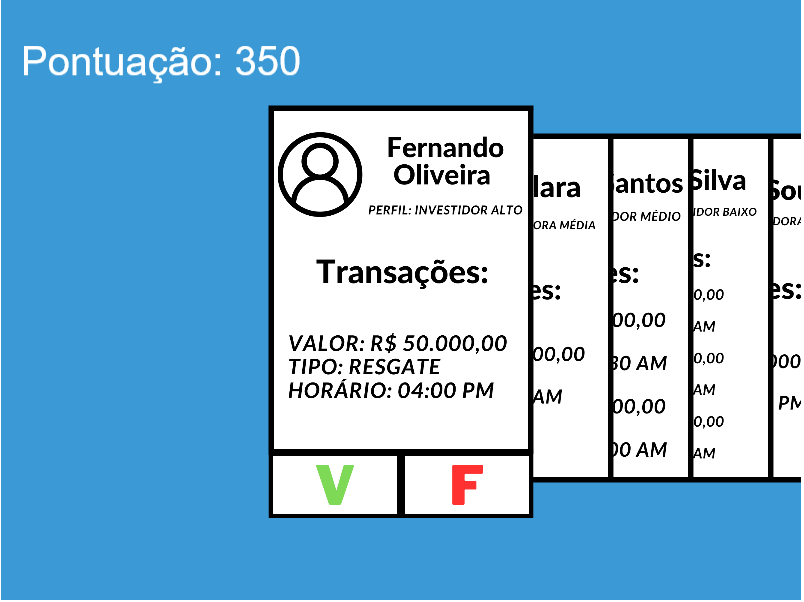

O terceiro _minigame_ retrata os conteúdos por traz do processo de resgate da cotação. O jogador precisa colocar, em uma linha do tempo, a ordem dos acontecimentos em um resgate típico de valores. Isso pode ser feito ao clicar em um _card_ na parte superior da tela, depois clicando na sua posição correspondente na parte inferior. Após todos os _cards_ serem posicionados, basta clicar na seta que aparece na tela, para receber a sua pontuação.

_Gameplay_ do _minigame_ 3:

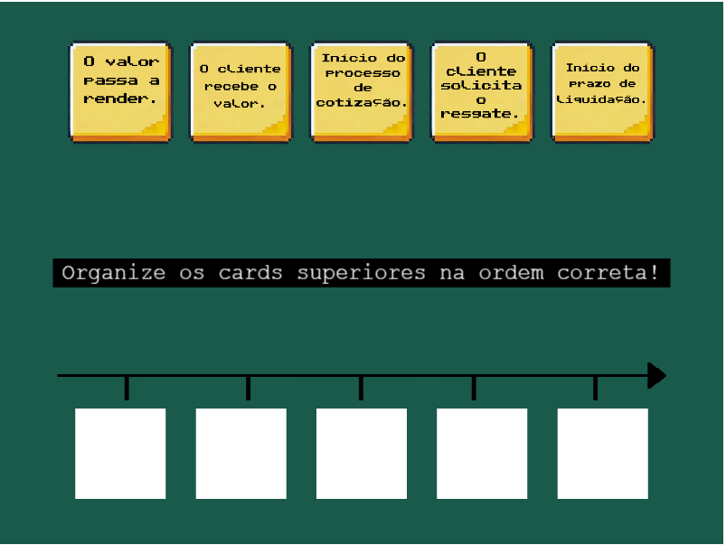

É importante destacar que cada um desses _minigames_ contém um material de apoio específico, indicando a maneira correta de jogar, além das informações necessárias para compreender o conteúdo por traz do minijogo.

Exemplo do material de apoio do _minigame_ 1:

A escolha desses _minigames_ específicos para a entrega dessa _sprint_ se deve ao fato de eles não serem extremamente complexos, tanto no quesito da programação quanto para a experiência do usuário. Assim, eles servem como uma forma de introdução para o _gameplay loop_ do nosso jogo.

Exemplo do código do _minigame_ 2:

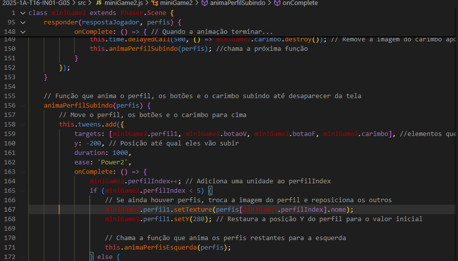

Também fizemos algumas atualizações para outras telas diversas do jogo, adicionando novas informações em pontos necessários. Entre essas mudanças, gostaríamos de destacar a _hub_. O seu mapa foi expandido, contando com novas salas e objetos interativos. Cada um desses objetos leva à um _minigame_ diferente, podendo ser interagidos em qualquer ordem. Eles possuem um ponto de exclamação ao seu lado, indicando que as tarefas ainda não foram realizadas. Cada _minigame_ pode ser jogado uma vez.

Layout da _hub_:

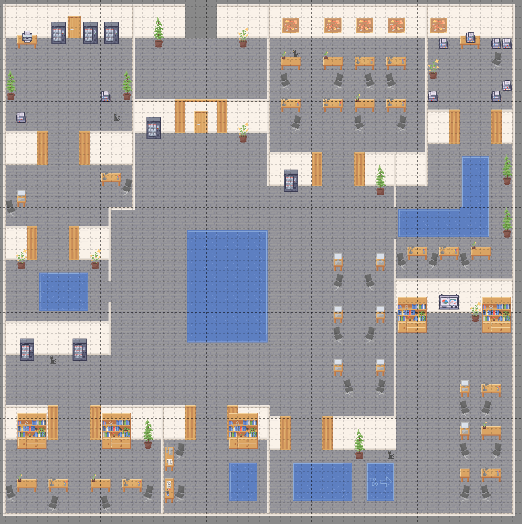

Exemplo de objeto interativo na _hub_:

Além disso, implementamos o primeiro personagem jogável do nosso jogo. As suas animações foram feitas com base em uma _spriesheet_, que representa diferentes _frames_ (quadros) da animação do personagem. Optamos por realizar sua inclusão na segunda _sprint_, como forma de tornar a cena da _hub_ mais completa, melhorando a experiência do usuário.

_Spritesheet_ do personagem:

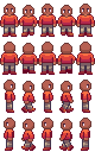

Por fim, também atualizamos a tela inicial do jogo, trazendo uma imagem de fundo animada. Ela também apresenta o logo do nosso jogo, trazendo uma maior identificação do jogador com o nosso _game_.

Menu inicial:

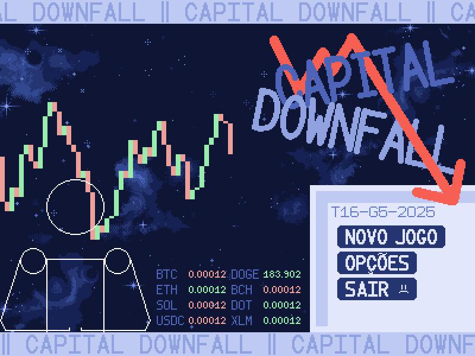

De forma geral, a _sprint_ 2 ficou marcada pelo desenvolvimento de novas habilidades, além de uma maior clarificação dos objetivos do nosso projeto. Ainda enfrentamos diversos desafios, principalmente em relação ao tempo de desenvolvimento, mas conseguimos cumprir as tarefas necessárias, tanto para o entregável quanto para apresentação ao parceiro.

Para os próximos passos, iremos implementar novas fases (dias) no nosso jogo, trazendo uma maior variedade de conteúdos. Também levaremos em conta o _feedback_ feito pelo parceiro.

## 4.3. Desenvolvimento intermediário do jogo (sprint 3)

_Descreva e ilustre aqui o desenvolvimento da versão intermediária do jogo, explicando brevemente o que foi entregue em termos de código e jogo. Utilize prints de tela para ilustrar. Indique as eventuais dificuldades e próximos passos._

## 4.4. Desenvolvimento final do MVP (sprint 4)

_Descreva e ilustre aqui o desenvolvimento da versão final do jogo, explicando brevemente o que foi entregue em termos de MVP. Utilize prints de tela para ilustrar. Indique as eventuais dificuldades e planos futuros._

## 4.5. Revisão do MVP (sprint 5)

_Descreva e ilustre aqui o desenvolvimento dos refinamentos e revisões da versão final do jogo, explicando brevemente o que foi entregue em termos de MVP. Utilize prints de tela para ilustrar._

# 5. Testes

## 5.1. Casos de Teste (sprints 2 a 4)

Os seguintes casos de teste abordam o funcionamento dos _minigames_ e da _hub_ referentes ao dia 1 do jogo, além do funcionamento do menu inicial.

|número | pré-condição | descrição do teste                                                            | pós-condição                       |                                                                                                                       
| ----  | -------      | ----------------------------------------------------------------------------- |----------------------------------- | 
| 1            | entrar no _link_ do jogo                                                      | apertar o botão: jogar                                                                              | o jogo deve passar para uma cena explicando os controles básicos                                                                                                  |
| 2            | posicionar o personagem em em frente a um objeto que ainda não foi interagido | enquanto o personagem estiver colidindo com o objeto, apertar a barra de espaço                     | a explicação do _minigame_ deverá aparecer                                                                                                                        |
| 3            | iniciar o _minigame_ 1 (fundos de investimento)                               | arrastar o _card_ para uma das gavetas                                                              | o _card_ deverá sair da tela, a pontuação aumentar/diminuir (dependendo da precisão da resposta) e um novo card deverá entrar na tela                             |
| 4            | iniciar o _minigame_ 2 (transações suspeitas)                                 | clicar no botão de verdadeiro ou falso                                                              | o _card_ deverá sair da tela, a pontuação aumentar/diminuir (dependendo da precisão da resposta) e um dos _cards_ laterais deve ocupar a posição do _card_ antigo |
| 5            | iniciar o _minigame_ 3 (processo de resgate)                                  | clicar em um _card_ na parte superior da tela, e depois clicar em outro _card_ ao lado              | o jogo deverá impedir a seleção de outro _card_, mantendo o original selecionado                                                                                  |
| 6            | iniciar o _minigame_ 3 (processo de resgate)                                  | clicar em um _card_ na parte superior da tela, e depois clicar em uma posição na linha do tempo     | o _card_ deverá se deslocar até a posição designada                                                                                                               |
| 7            | realizar o teste número 6                                                     | clicar em um _card_ que já está na linha do tempo, e depois clicar em outro local na linha do tempo | o jogo deverá impedir que essa mudança ocorra, para evitar erros                                                                                                  |
| 8            | iniciar algum dos _minigames_                                                 | finalizar o _minigame_                                                                              | o jogo deverá voltar até a _hub_, e o ponto de exclamação azul ao lado do terminal do _minigame_ escolhido deverá sumir                                           |
| 9            | posicionar o personagem em em frente a um objeto que já foi interagido        | enquanto o personagem estiver colidindo com o objeto, apertar a barra de espaço                     | o jogo deverá impedir que o _minigame_ ocorra novamente |                                                                                                          

## 5.2. Testes de jogabilidade (playtests) (sprint 4)

### 5.2.1 Registros de testes

_Descreva nesta seção as sessões de teste/entrevista com diferentes jogadores. Registre cada teste conforme o template a seguir._

| Nome                                     | João Jonas (use nomes fictícios)                                                                                                         |
| ---------------------------------------- | ---------------------------------------------------------------------------------------------------------------------------------------- |
| Já possuía experiência prévia com games? | sim, é um jogador casual                                                                                                                 |
| Conseguiu iniciar o jogo?                | sim                                                                                                                                      |
| Entendeu as regras e mecânicas do jogo?  | entendeu as regras, mas sobre as mecânicas, apenas as essenciais, não explorou os comandos complexos                                     |
| Conseguiu progredir no jogo?             | sim, sem dificuldades                                                                                                                    |
| Apresentou dificuldades?                 | Não, conseguiu jogar com facilidade e afirmou ser fácil                                                                                  |
| Que nota deu ao jogo?                    | 9.0                                                                                                                                      |
| O que gostou no jogo?                    | Gostou de como o jogo vai ficando mais difícil ao longo do tempo sem deixar de ser divertido                                             |
| O que poderia melhorar no jogo?          | A responsividade do personagem aos controles, disse que havia um pouco de atraso desde o momento do comando até a resposta do personagem |

### 5.2.2 Melhorias

_Descreva nesta seção um plano de melhorias sobre o jogo, com base nos resultados dos testes de jogabilidade_

# 6. Conclusões e trabalhos futuros (sprint 5)

_Escreva de que formas a solução do jogo atingiu os objetivos descritos na seção 1 deste documento. Indique pontos fortes e pontos a melhorar de maneira geral._

_Relacione os pontos de melhorias evidenciados nos testes com plano de ações para serem implementadas no jogo. O grupo não precisa implementá-las, pode deixar registrado aqui o plano para futuros desenvolvimentos._

_Relacione também quaisquer ideias que o grupo tenha para melhorias futuras_

# 7. Referências (sprint 5)

MAGRETTA, Joan. Entendendo Michael Porter: o guia essencial da competição e estratégia. Rio de Janeiro: Alta Books, 2019. 1 recurso online. ISBN 9788550805047. Disponível em: https://integrada.minhabiblioteca.com.br/books/9788550805047. Acesso em: 23 fev. 2025. 

MOBA, RPG, MMORPG, FPS e mais: entenda significado dos gêneros de games. Disponível em: https://www.techtudo.com.br/noticias/2021/03/moba-rpg-mmorpg-fps-e-mais-entenda-significado-dos-generos-de-games.ghtml. Acesso em : 23 fev. 2025. 

NAKAGAWA, Marcelo. Ferramenta: 5 Forças de Porter. [S. l.: s. n.], [20--]. Disponível em: https://sebrae.com.br/Sebrae/Portal%20Sebrae/Anexos/ME_5-Forcas-Porter.PDF?ref=productoversee.com. Acesso em: 23 fev. 2025. 

BTG PACTUAL.Negócio e Histórico,2025.Disponível em: https://ri.btgpactual.com/sobre-o-banco/negocio-e-historico/#:~:text=O%20Banco%20BTG%20Pactual%20%C3%A9,internacional%20de%20investimentos%20e%20distribui%C3%A7%C3%A3o. Acesso em : 23 fev. 2025. 

SEBRAE.Público Alvo,2025.Disponível em : https://sebrae.com.br/sites/PortalSebrae/artigos/como-determinar-o-publico-alvo-da-sua-empresa,fa1c7553c86c6810VgnVCM1000001b00320aRCRD. Acesso em : 23 fev. 2025. 

POLTERGEISTERS. Slightly Cuter Character Sprites. Nexus Mods, 2017. Disponível em: https://www.nexusmods.com/stardewvalley/mods/1437. Acesso em: 27 fev. 2025.

ALIYACH. Portrait Accurate NPC Sprites. Nexus Mods, 2023. Disponível em: https://www.nexusmods.com/stardewvalley/mods/17289. Acesso em: 27 fev. 2025.

DEEP-FOLD. PixelSpace. GitHub, 2021. Disponível em: https://github.com/Deep-Fold/PixelSpace. Acesso em: 27 fev. 2025.

# Anexos

_Inclua aqui quaisquer complementos para seu projeto, como diagramas, imagens, tabelas etc. Organize em sub-tópicos utilizando headings menores (use ## ou ### para isso)_
